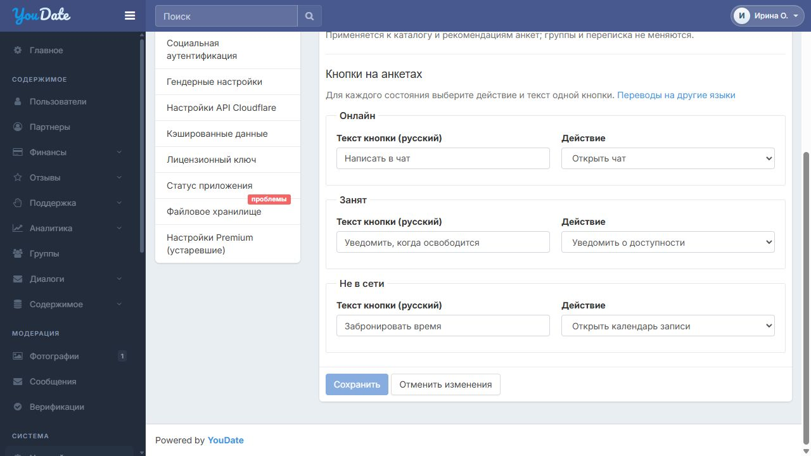
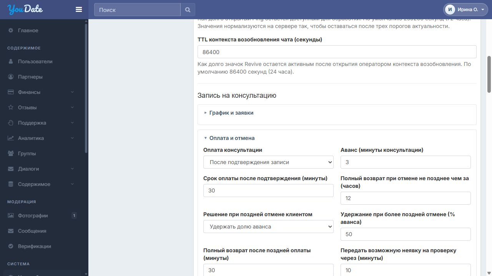
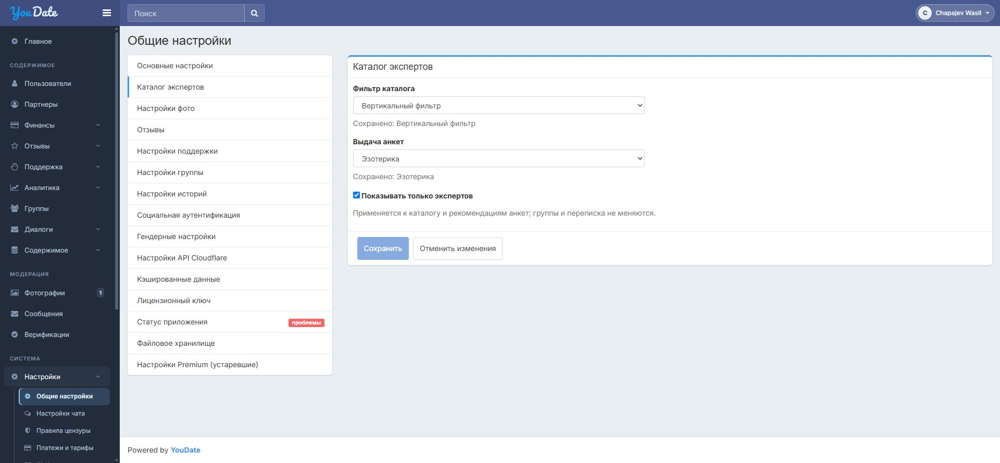

# Задача 3. Настройки платного чата, кнопок и записи

[Основное ТЗ в Google Документе](https://docs.google.com/document/d/18HSTZvkFnRUKOTcrbttiz_dX_0IEFGqaVcJKG4YTouc/edit) · [Макет кнопок](https://cutthreat.github.io/confideline/deliveries/agent-schedule-20261112/settings-mockup/expert-buttons.html) · [Макет параметров записи](https://cutthreat.github.io/confideline/deliveries/agent-schedule-20261112/settings-mockup/paid-chat.html) · [Настройки уведомлений клиента](https://cutthreat.github.io/confideline/deliveries/agent-schedule-20261112/settings-mockup/client-channels.html)

Предварительное ТЗ для обсуждения с Игорем · обновлено 14 ноября 2026

Макеты: существующие настройки чата с добавленными параметрами, существующий каталог экспертов с настройкой кнопок, выбор клиента.

## Где разместить настройки

Действующие страницы: Настройки чата, Общие настройки → Каталог экспертов и Языки. Переключатель и общие параметры записи разместить внутри существующей формы настроек чата; настройку кнопок — внутри существующей формы каталога экспертов. Не добавлять в глобальное меню три новых пункта «Платный чат», «Кнопки эксперта» и «Каналы событий записи». Сохранить прежнюю навигацию, поля, кнопки сохранения и их поведение. Макет является предложением расположения, а не внедрённой функцией. На существующей странице клиента «Настройки → Уведомления» (https://confideline.com/ru/settings/notifications) сохранить все прежние настройки и добавить выбор каналов записи.

## Зачем нужна доработка

Администратору нужно отдельно управлять платной составляющей чата, действиями и видимостью кнопок на анкетах, ценами и общими условиями записи. События записи всегда остаются в чате, а дополнительные уведомления клиент выбирает из каналов, разрешённых сайтом.

Результат: настройки сохраняются в существующей админке и применяются на сайте. Карточка эксперта Confideline остаётся прежней; меняются только предусмотренные кнопки. Агент и эксперт не задают цены, возвраты и финансовые правила.

## 1. Платный чат и действующие обязательства

Администратор включает и выключает платный чат независимо от режима выдачи анкет. Выключение останавливает новые платные заявки и сеансы без ранее принятой записи; обычная бесплатная переписка сохраняется. Сеанс по ранее принятой записи остаётся доступен, пока выполняются существующие обязательства. Услугу оказывает только анкета с внутренним признаком эксперта. Иные различия анкет на фронте не вводить.

Если уже есть поданные заявки и будущие встречи, сначала остановить новые платные заявки, а ранее принятые обязательства довести до результата по прежним условиям и срокам. В настройках показать переходное состояние «Завершение обязательств» и перечень оставшихся консультаций, заявок, ожидающих подтверждения или оплаты, и будущих подтверждённых встреч. Клиент должен иметь путь к уже подтверждённой консультации через связанный диалог. После обработки обязательств платная функция выключается полностью. Подписки ожидания могут оставаться для бесплатного чата с понятным сообщением о недоступности платной услуги. Количества на макете приведены только для примера.

## 2. Кнопки и переводы

Для каждого состояния «Онлайн», «Занят» и «Не в сети» администратор задаёт текст и одно основное действие: открыть чат, уведомить о доступности, открыть календарь записи, перейти по ссылке или скрыть кнопку. Начальные варианты: онлайн — «Написать в чат», занят — «Уведомить, когда освободится», не в сети — «Забронировать время». Администратор может изменить текст и действие независимо для каждого состояния. Например, занятому назначить запись, а офлайн-эксперту — уведомление. В карточке показывают одну основную кнопку; в окне уведомления можно перейти к записи без создания подписки. Ссылки, доступность сценария и права проверяют на сервере; второй платный чат занятого агента запрещён независимо от выбранной кнопки.

Русскую подпись администратор меняет непосредственно в настройке состояния, как в макете. Для каждого состояния нужна независимая запись в существующем языковом словаре: изменение подписи не меняет другие состояния и чужие надписи. Переводы остальных языков редактируются через действующий раздел «Языки». Изменение действия не меняет текст. Порядок подстановки при отсутствии перевода сверить с действующей системой.

Новые надписи и сообщения интерфейса переводить штатным способом сайта. Страны, города и bio со своими индивидуальными описаниями сюда не переносить.

Ранее согласовано показывать основной язык сайта при отсутствии перевода; владелец предложил использовать английский. Фактический общий fallback ещё не проверен, окончательный порядок необходимо согласовать. Внешний вид кнопок можно соотнести с MakTaro, оставив остальную карточку Confideline без изменений.

## 3. Цены, общие условия и параметры записи

Уполномоченный администратор задаёт персональную цену минуты на экспертной анкете; при пустом поле используется общий тариф сайта, если он задан. Персональный ноль запрещает новые платные консультации этой анкеты; общий нулевой тариф запрещает новые платные услуги сайта. Если применимой цены нет, платная услуга недоступна, администратор видит необходимость настройки; бесплатная переписка работает. Цена и условия фиксируются при отправке заявки и сохраняются для этой записи, даже если администратор позже изменит тариф или общие настройки.

Финансовые режимы «после подтверждения» и «после начала», размер аванса в минутах и другие исполняемые параметры — общие настройки администратора. Размер аванса и срок оплаты настраивает администратор; три минуты и 30 минут в примерах — значения для проверки, не константы и не обязательные стартовые настройки. Тексты условий оплаты, отмены и возврата находятся в существующем разделе «Страницы», чтобы клиент видел их заранее. Применение условий к конкретной записи реализует задача 2.

Администратор задаёт плановое окно, шаг начала и горизонт записи; срок ответа агента и минимальный запас до встречи; напоминания и срок ожидания доступности; режим и срок переноса; порядок оплаты, число минут аванса и срок оплаты; порог полного возврата, правило и процент поздней отмены, льготный период, порог и срок рассмотрения возможной неявки, а также срок эскалации неизвестной оплаты. При отмене можно выбрать полный возврат, удержание заданной доли или проверку сотрудником. Период и минимальную сумму выплаты, а также способ её проведения задавать в действующем финансовом разделе; уже имеющиеся параметры не дублировать. Консультация не ограничивается плановым окном. Новые параметры применять к новым заявкам; цену, сроки, аванс и условия действующей заявки сохранять. Числа в макетах и примерах — значения для обсуждения и проверки, а не константы кода. Неутверждённые начальные значения согласовать.

Сохранять существующие разделы карточки эксперта и кнопку «Баланс». У агента остаётся управление графиком и заявками, но нет редактирования цены и финансовой политики.

## 4. Каналы клиента

Системные события действующей записи всегда отображаются в связанном чате; отключить их не может ни администратор, ни клиент. При выборе каналов клиенту ясно показывать это правило. Администратор задаёт доступность уведомлений сайта и писем, клиент выбирает нужные из разрешённых и может не выбирать ни одного дополнительного канала. Выбор разместить на существующей странице «Настройки → Уведомления» (https://confideline.com/ru/settings/notifications), сохранив все её прежние настройки и навигацию; дополнительные настройки записи являются предложенной доработкой. Изменение глобальных настроек и личного выбора сохраняется и учитывается при доставке; отключённый администратором дополнительный канал нельзя выбрать. Настройка подписки «Уведомить об освобождении» для сайта и почты учитывается отдельно. Сами события и доставка — задача 2; отображение системных событий в рабочем чате агента — задача 1.

Для уведомлений об освобождении клиент отдельно выбирает разрешённые каналы на этой же странице. Если он не выбрал ни одного разрешённого канала, при попытке подписаться предложить открыть настройки и выбрать способ; если оба запрещены администратором — сообщить, что уведомление недоступно. Настройки не создают подписку автоматически. При последующем отключении каналов уже созданное ожидание сохраняется до прежнего срока; правила восстановления и отправки описаны в задаче 2. Это отдельное правило и не отменяет обязательные события записи в чате.

Важно: Событие в чате доступно клиенту при открытии диалога; само по себе это не означает, что он его прочитал или получил письмо либо сайт-уведомление.

## Проверки для приёмки

Проверки выполняются после реализации.

| № | Что проверить | Ожидаемый результат |
| --- | --- | --- |
| 1 | Включить/выключить платный чат без записей и при наличии активных обязательств. | Новые платные сценарии останавливаются; бесплатный чат работает, подтверждённые встречи доводятся до результата через связанный чат. |
| 2 | Для каждого статуса изменить текст и действие, сохранить и повторно открыть. Отдельно назначить занятому эксперту запись, а офлайн — уведомление. | Выборы сохраняются независимо; при смене статуса отображается заданная кнопка, выполняется выбранное допустимое действие. |
| 3 | Изменить перевод фразы одной кнопки в общем разделе «Языки», открыть клиентскую страницу на двух активных языках и проверить остальные кнопки и тексты. | Меняется только связанная подпись; действие, остальные кнопки и чужие надписи сохраняются. Новый перевод найден штатным сканером и словарём. Реальный fallback при отсутствии перевода сверяется отдельно. |
| 4 | Проверить личную цену, пустое поле, личный и общий ноль; отдельно ранее оформленную запись. | Новые платные услуги следуют указанным правилам; цена прежней записи неизменна; бесплатный чат доступен. |
| 5 | Задать оба режима оплаты и параметры графика, изменить их после заявки. | Новые значения доступны новым сценариям; уже принятые цена, режим и аванс не переписываются. |
| 6 | Отключить дополнительные каналы администратором; отдельно отключить их клиентом, сохранить настройки и изменить запись. Для ожидания эксперта проверить отсутствие выбора, запрет обоих каналов и их отключение после подписки. | Системное событие записи доступно в чате всегда. Уведомления используют разрешённые и выбранные каналы; без них новое ожидание не создаётся, прежнее сохраняет срок. Причина недоступности понятна клиенту. |
| 7 | Попытаться изменить цену и финансовые правила ролью агента, в том числе прямым запросом. | Сервер запрещает изменение; существующая кнопка «Баланс» и разрешённые функции не исчезают. |
| 8 | Проверить карточки и настройки на широком и узком экране. | Карточка Confideline сохранена, кнопки читаемы; новые стили не меняют другие страницы. |
| 9 | Открыть исходные настройки чата, каталога и клиентских уведомлений после доработки. | Все прежние поля, выборы и ссылки сохранены, новые параметры находятся в существующих формах, лишних пунктов меню нет. |
| 10 | Выключить платную функцию при существующих заявках. | Видны переходное состояние и оставшиеся обязательства; после их обработки состояние становится выключенным. |

## Связь с другими задачами

Зависимости: задача 1 использует настройки сеанса, кнопок и каналов; задача 2 исполняет запись, тарифы и уведомления. Настройку можно проверить отдельно на тестовом сценарии, сквозную работу — после готовности всех трёх задач.

Макеты настроек.

Действующая страница «Каталог экспертов», 12 ноября 2026 года.

