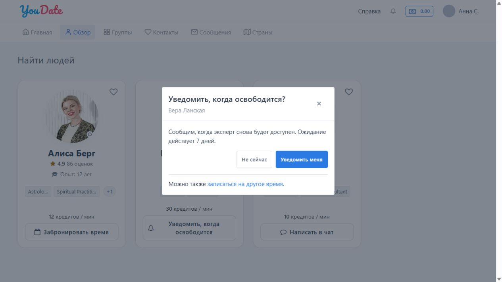
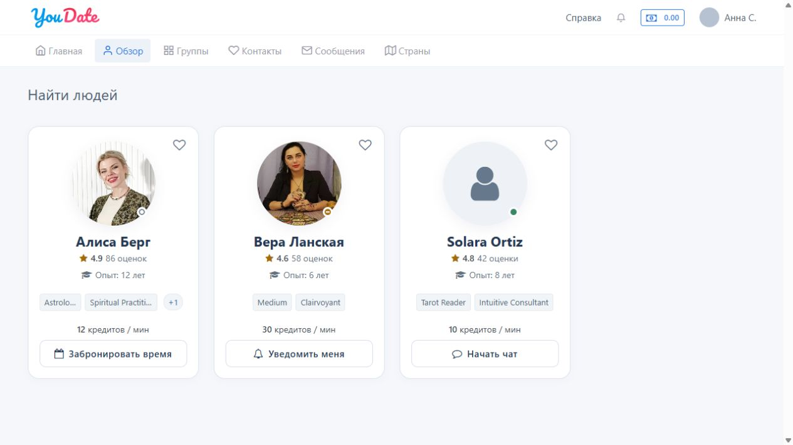
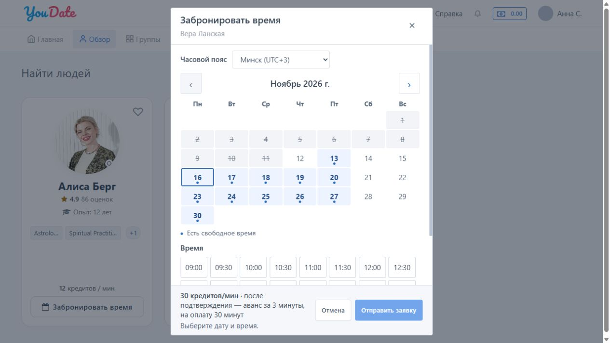
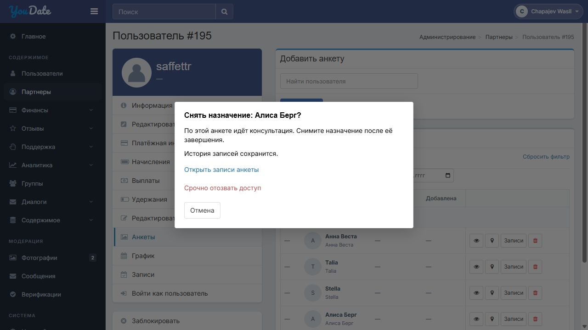
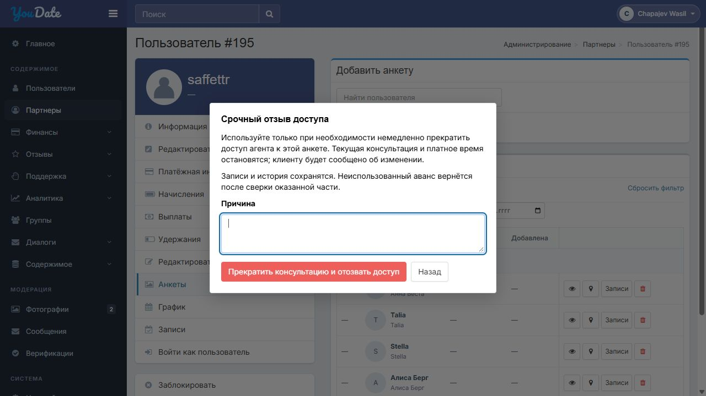
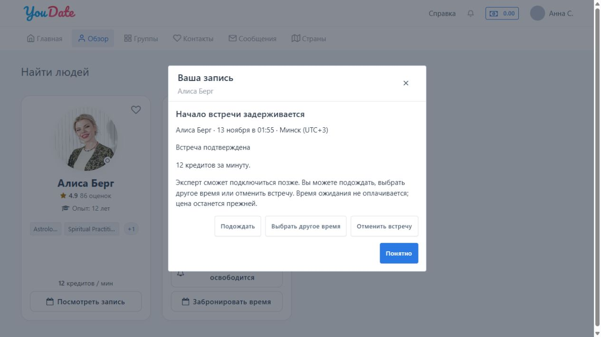

# Задача 2. Запись на консультацию: календарь, график агента и уведомления

Предварительное ТЗ для обсуждения с Игорем · редакция 14 ноября 2026

**Макеты:** [выбор времени клиентом](https://cutthreat.github.io/confideline/deliveries/agent-schedule-20261112/client/index.html) · [единый график агента](https://cutthreat.github.io/confideline/deliveries/agent-schedule-20261112/admin/partner.html#schedule) · [журнал записей агента](https://cutthreat.github.io/confideline/deliveries/agent-schedule-20261112/admin/partner.html#bookings). Снимки: [календарь клиента](https://cutthreat.github.io/confideline/deliveries/agent-schedule-20261112/visual/client-booking.jpg) · [график агента](https://cutthreat.github.io/confideline/deliveries/agent-schedule-20261112/visual/agent-schedule.jpg). Макеты демонстрируют предложенное поведение; серверные операции ещё не реализованы.

## Зачем нужна доработка

На сайте ещё нет согласованного механизма записи и уведомления об освобождении эксперта. Клиенту нужно выбрать свободное время и получить консультацию по заранее понятной цене; агенту — управлять своим рабочим временем и заявками по всем закреплённым анкетам без пересекающихся встреч.

**Результат:** клиент видит реальные свободные окна и оформляет заявку, агент подтверждает её в управлении записями, сайт удерживает общее время агента, сообщает о состоянии и применяет общие условия оплаты. Вход — существующая карточка Confideline: её содержимое и расположение элементов сохраняются, меняются только согласованные кнопки. В макете показаны три состояния карточки, в каждом одна основная кнопка. Начальные настройки: онлайн — «Написать в чат», занят — «Уведомить, когда освободится», не в сети — «Забронировать время». Администратор может изменить текст и действие для каждого состояния; например, назначить запись занятому эксперту, а уведомление — офлайн. При начальных настройках онлайн-анкета открывает обычный чат. При изменении статуса действия на карточке обновляются, но уже начатая заявка не пропадает. Уже открытое окно не закрывают и введённое не стирают; перед подтверждением повторно проверяют выбранную анкету, цену, доступность времени и право действия. Если условия изменились, клиенту объясняют это и предлагают доступный вариант без скрытой подмены анкеты или цены. В окне уведомления клиент может перейти к записи на другое время без обязательной подписки; существующую подписку этот переход не отменяет. Внутренние изменения должны по возможности проходить для клиента незаметно: сохраняются выбранная анкета, согласованное время и цена. Если встреча всё же затрагивается, клиент своевременно и честно узнаёт только то, что ему нужно для решения: доступные варианты ожидания, переноса или отмены и условия возврата. Без согласия клиента нельзя менять время, подменять выбранную анкету или ухудшать цену; за ожидание платное время не списывается. Внутренние назначения и служебные причины клиенту не показываются. Для оформления кнопок можно ориентироваться на [MakTaro](https://maktaro.com/account/psychics.html), не заменяя карточку целиком.

## 1. График и общий ресурс агента

- У партнёра есть его собственный рабочий график: рабочие и выходные дни, часы, перерывы и исключения. Агент задаёт один график, который действует для всех закреплённых за ним экспертных анкет. Единый график и общий журнал записей размещаются в карточке партнёра; записи конкретной анкеты доступны также в её контексте. Существующие функции и таблицы сохраняются; журнал не объединяется с Chat V2. Клиент управляет только своими заявками. Агент под собственной учётной записью управляет своим графиком и заявками закреплённых за ним анкет; администратор и сотрудник финансовой сверки действуют в рамках имеющихся прав. Сервер проверяет полномочия на каждое действие, включая показ, оплату, отмену, перенос и возврат; чужие записи агенту не открывать. Существующую модель прав сохранить и сверить её с Игорем.
- Отдельных графиков у экспертных анкет нет. В карточке экспертной анкеты показывать список её записей; календарь и настройка рабочего времени находятся в карточке агента. Если агент изменяет рабочее время, новые свободные окна пересчитываются для всех его анкет. Например, если агент работает с 09:00 до 18:00 и клиент записался через одну анкету на 09:30, пересекающееся время становится недоступным для записи через остальные анкеты этого агента.
- Запись или удержание через одну анкету занимает соответствующее время общего ресурса агента для всех его анкет. Клиент видит свободное время единого графика агента у каждой закреплённой за ним экспертной анкеты. Два клиента не могут одновременно получить пересекающееся время через разные анкеты одного агента; соседние окна и другие агенты не блокируются без основания. Если агент анкете не назначен, окна записи по этой схеме не формируются. В макете снять назначение без замены нельзя, пока у анкеты есть активные заявки или записи: сначала их нужно разобрать либо передать анкету другому агенту. Если по анкете идёт консультация, обычное снятие назначения и передача запрещены до её завершения. Это относится также к пробной консультации, паузе и восстановлению связи: консультация и её учёт продолжаются по действующим правилам, а агент, который её проводил, сохраняется в истории и расчётах. Администратор видит: «По этой анкете идёт консультация. Снимите назначение после её завершения». При срочном отзыве доступа из соображений безопасности уполномоченный администратор использует отдельное защищённое действие: доступ агента к этой анкете отзывается, платное время останавливается, причина и состояние сеанса фиксируются. Перед действием администратор видит последствия, обязательно указывает причину и отдельно подтверждает отзыв. Права проверяются на сервере; повторное нажатие не создаёт повторной остановки или возврата. Неиспользованный аванс возвращается в кредиты после сверки фактически оказанной части; при неизвестном результате повторные финансовые операции не выполняются. Будущие записи сохраняются, за их разбор отвечает администратор: он ищет доступного агента, чтобы сохранить выбранную анкету, время и цену. Если встреча затрагивается, клиенту своевременно предлагают ожидание, согласованный перенос или отмену с возвратом по разделу 4; при наступлении времени без решения запись передают на проверку. Без назначенного агента новые окна не предлагаются. При переназначении новые окна берутся из графика нового агента, а существующие записи сохраняются и проверяются на конфликты. Текущая платная консультация и будущая запись — разные состояния: занятость сейчас не закрывает все будущие окна. Пока агент проводит платную консультацию, все его закреплённые анкеты, которые иначе были бы онлайн, показывают «занят»; это действует также во время пробных минут, паузы и восстановления связи. Анкеты не в сети остаются не в сети. После завершения сеанса доступность каждой анкеты определяется действующими правилами и настройками; автоматически переводить все анкеты в онлайн нельзя.

**Назначение во время консультации:** [открыть макет](admin/partner.html?scenario=active-session#profiles)

- Изменение графика агента сохраняется даже при конфликте с существующей заявкой, ожидающей оплаты или подтверждённой встречей. Заявка, встреча и прежние сроки не исчезают; конфликт виден агенту и администратору. Время встречи меняется только с согласия клиента.

## 2. Заявка клиента

Клиент открывает календарь, видит доступные месяц, день и время в своём часовом поясе, цену минуты и условия, выбирает начало и отправляет заявку. При неизвестном часовом поясе сайт должен дать клиенту выбрать его до отправки. Агент видит своё местное время. Моменты хранятся как абсолютное время; несуществующее при переводе часов местное время не предлагается, а при повторении одного местного времени показываются разные смещения часового пояса. После изменения графика ранее показанные сроки существующей заявки и оплаты не пересчитываются.

Клиент **не выбирает длительность консультации**. Администратор задаёт стандартное плановое окно, шаг предлагаемых начал и период доступных дат в задаче 3. Окно занимает время в графике, но не ограничивает саму консультацию: она продолжается по обычным правилам, пока хватает кредитов, если следующая запись не требует завершить разговор. При следующей встрече агенту нужно завершить консультацию корректно; предупреждение — задача 1. Пока первая платная консультация не завершена, сервер не допускает запуск второй консультации этим агентом ни через одну из его анкет. Клиенту следующей записи показывается задержка и предлагаются ожидание, перенос или отмена по правилам ниже. Автоматически прерывать первую консультацию только из-за наступления следующей записи не требуется.

Перед созданием заявки повторно проверять свободное время, назначение и показанную цену. Если что-то изменилось, сообщить клиенту и предложить выбрать заново или согласиться с актуальной ценой **до создания заявки**. После успешной подачи удерживать окно и показать точный срок ответа. Повторное нажатие и потеря сетевого ответа не создают вторую заявку; сначала выясняется исход исходной. Сервер при каждом действии проверяет актуальное состояние, срок, версию и права, а проверку общего окна агента, его удержание и изменение записи выполняет как одну защищённую операцию. При одновременных подтверждении, истечении, оплате, отмене или переносе фиксируется только первый допустимый исход; повтор получает текущее состояние или понятный отказ без второй финансовой операции. Если отмена зафиксирована первой, перенос применить нельзя; если первым применён перенос, условия отмены считаются от нового времени. При передаче анкеты проверка пересечений и сохранение существующих обязательств выполняются вместе; конфликт сохраняется для разбора и не разрешает второй одновременный платный чат.

Срок ответа агента в рабочих часах, минимальный запас до встречи и сроки напоминаний задаёт администратор. Рабочие часы считаются по общему графику агента с учётом перерывов, выходных и исключений. Если заданный срок ответа не помещается до допустимой границы встречи, время для предварительной записи не предлагать. По заданным интервалам агент получает напоминание, а ответственному направляется сигнал. Последний сигнал сам по себе заявку не отменяет. Если к показанному клиенту сроку ответа нет, заявка закрывается, окно освобождается, клиент получает результат. Время, для которого срок ответа не помещается, как срочную запись пока не предлагать; обычный чат и немедленная консультация при доступности остаются.

Агент видит новые заявки и историю в общем журнале партнёра и в контексте нужной анкеты, может подтвердить, отклонить или предложить перенос в рамках прав. Это одна и та же запись в обоих представлениях. Заявка сначала ожидает ответа агента. Он может подтвердить её или отклонить; клиент может отменить, а по истечении срока ответа заявка закрывается. При подтверждении в режиме аванса заявка ожидает оплаты и становится подтверждённой после своевременного списания; в режиме без аванса встреча подтверждается сразу. Подтверждённая встреча затем завершается или отменяется. Проверка оплаты — финансовый признак существующей записи, а не новая заявка. До решения: «ожидает оплаты + проверяется»; после отказа клиента: «отменена + проверяется»; если списание подтвердилось: «отменена + возврат в обработке», затем «отменена + возвращено». Если списания не было, сохраняют «отменена + списания нет». Отменённую запись после сверки не подтверждают повторно. Перенос — предложение к той же записи и меняет время только после действительного согласия и устранения конфликта. Предложение другого времени означает готовность агента, если окно доступно. Согласие клиента на конфликтное предложение сохраняется, но новое время не подтверждено до устранения конфликта: клиент видит «Новое время уточняется». Если конфликт решён до срока без изменения предложения, повторно согласие не запрашивается. Для новой и существующей пары клиент — анкета заявка также появляется в Chat V2 по задаче 1.

## 3. Цена, оплата и возврат

Расчёт, списание и возврат аванса по правилам этого ТЗ входят в задачу записи и проверяются вместе с ней. Использовать подходящие действующие операции баланса после проверки кода и прав; если нужной операции нет, Игорь согласует способ её добавления. Новая бухгалтерская отчётность и финансовые правила, не описанные здесь, остаются отдельной задачей. Администратор задаёт цену минуты анкеты и общие правила оплаты в задаче 3; агент финансовые условия не меняет. При отправке заявки фиксируются показанные клиенту цена минуты, режим оплаты, число предоплачиваемых минут и сумма аванса. Цена данной записи не меняется до оказания услуги — независимо от наличия аванса и последующей смены тарифов.

Сайт поддерживает два глобальных режима:

1. **После подтверждения агентом.** Клиенту предлагается оплатить аванс кредитами за настроенное администратором количество минут; три минуты в примерах — демонстрационное значение. Срок оплаты задаёт администратор; окно удерживается до оплаты, но не дольше показанного клиенту срока. Числа в примерах и проверках ниже иллюстрируют конкретную настройку; их нельзя жёстко задавать в коде. Условия подтверждённой заявки сохраняются при последующем изменении настроек. Недостающие кредиты можно пополнить штатным способом без продления срока. Встреча окончательно подтверждается, если аванс с кредитного баланса успешно списан строго раньше срока. Ровно в момент срока и позднее новая оплата не принимается. 
Для границы срока действует время сервера. Если на момент срока достоверно установлено, что списания и подтверждения нет, заявка истекает и окно освобождается. 
Если исход операции неизвестен, срок оплаты не продлевается и повторную оплату не предлагают, а окно временно не показывают другим клиентам до сверки, но не дольше конца запланированного окна записи: это защита уже отправленной оплаты, а не дополнительное время для неё. После сверки подтверждение, состоявшееся до срока, сохраняют; если списание не состоялось или произошло позднее, заявку закрывают и окно освобождают. Списание аванса и подтверждение записи выполняются атомарно относительно истечения срока и освобождения окна: если списание и подтверждение зафиксированы до срока, запись остаётся подтверждённой, даже если ответ клиенту пришёл позже; если срок наступил раньше, новое списание не выполняется и запись автоматически не восстанавливается. 
Если из-за сбоя аванс всё же списан после истечения, полную сумму возвращают на кредитный баланс один раз; окно повторно не занимают, клиенту сообщают о возврате и предлагают выбрать новое время. 
Если результат списания неизвестен, клиент видит «Проверяем оплату» и ссылку на поддержку; запись сразу поступает ответственному на сверку. Если исход не установлен за заданный администратором срок, система уведомляет администратора. Клиент может отказаться от ожидания: отмена фиксируется, окно освобождается, а после подтверждения любого списания весь аванс возвращается один раз; до результата показывают «Возврат в обработке». Если списания не было, возврат не создают. Если назначенное время наступило до выяснения оплаты, клиент не считается неявившимся, платный чат до сверки не запускают; ему доступны поддержка и отмена. После конца планового интервала старое окно не блокирует будущие интервалы, а финансовая проверка продолжается. Если своевременное списание подтвердилось после начала встречи, которая ещё не завершилась, сотрудник предлагает клиенту начать консультацию только по его согласию и при доступном агенте, согласовать перенос либо отменить с полным возвратом аванса за неоказанную услугу. Если к концу планового интервала платный чат не начался, после подтверждения списания весь неоказанный аванс автоматически возвращается один раз, запись отменяется и клиент получает уведомление. Перенос вместо отмены возможен только по инициативе и согласию клиента до возврата. При уже зафиксированной отмене клиентом возврат после подтверждения списания выполняется без повторного согласия. Повторное списание и повторный возврат не выполняются; напоминание не меняет финансового результата и не продлевает срок оплаты. 
Пополнение баланса — отдельная операция: зачисленные кредиты остаются на балансе, покупка автоматически не возвращается на карту и не оплачивает истёкшую заявку.
2. **После начала консультации.** До начала аванса и скрытого списания нет; встреча подтверждается агентом. Стоимость учитывается по зафиксированной цене при фактической платной консультации.

Аванс засчитывается в фактическую платную часть; неиспользованный остаток возвращается на кредитный баланс. Пробные минуты и учёт платной консультации работают по установленной стратегии и не запускаются до фактического начала. Аванс засчитывается в первые платные начисления: повторно списывать с баланса уже покрытые авансом кредиты нельзя. После исчерпания аванса действует штатный биллинг; окончательный расчёт и возврат остатка выполняются один раз. 
По документации Игоря для deferred_seconds без пробных минут первая платная минута учитывается целиком, затем активные секунды рассчитываются при завершении с округлением вверх до целого кредита; паузы и восстановление связи не оплачиваются. Для исторического minute_legacy учитывается каждая начатая минута. Игорь сверяет стратегию с установленным кодом и сохраняет её; новый лимит продолжительности или кредитов не вводится. Если платного времени не было, аванс возвращается полностью, кроме согласованной поздней отмены и подтверждённой неявки. 
Администратор задаёт порог полного возврата, порядок поздней отмены (полный возврат, удержание выбранной доли либо индивидуальная проверка), процент удержания и льготный период после поздней оплаты. До истечения выбранного порога возвращается весь аванс; позже применяется сохранённое для заявки правило. Льгота действует только до встречи. Например, при настройке 12 часов и 50% из аванса 31,01 удерживается 15,50 и возвращается 15,51 кредита; округление удержания вниз до 0,01 кредита сверить с действующим биллингом. 
После окончательного подтверждения переноса сохранённый в заявке срок полного возврата отсчитывается от нового времени. Льгота сохраняет первоначальные момент оплаты и срок: перенос её не запускает заново и не продлевает. Пока новое время не подтверждено, действует прежнее время с учётом отдельного порядка конфликта площадки. 
Если перенос потребовался из-за невозможности провести встречу со стороны площадки или агента, клиент вправе до начала новой встречи отказаться с полным возвратом неиспользованного аванса без удержания; эта причина имеет преимущество перед обычным правилом поздней отмены. Без аванса удерживать нечего. Перед подтверждением переноса и отмены клиенту показывают актуальные время и условия возврата; при неизвестной сумме сообщают, что возврат проверяется, не объявляя его выполненным. При отказе или неявке агента либо подтверждённом сбое сервиса неиспользованный аванс возвращается полностью.

Если клиент отменяет встречу после назначенного времени и до начала платного чата, при подтверждённой доступности услуги и до настроенного порога возможной неявки применяется сохранённое правило поздней отмены. После порога или при спорной доступности итог определяет уполномоченный сотрудник; до решения дополнительных удержаний нет. При задержке агента или недоступности услуги удержаний нет. По истечении настроенного порога возможная неявка передаётся на проверку; закрытая вкладка сама по себе не доказательство. При подтверждении уполномоченный сотрудник вручную определяет удержание от 0 до 100% аванса с точностью до 0,01 кредита и фиксирует причину; фиксированной шкалы и автоматического удержания нет; если случай не рассмотрен за заданный администратором срок от начала встречи, удерживаемый аванс возвращается. Когда аванса не было, удерживать его нельзя. Клиенту показывается итог и способ обратиться за пересмотром. Если при пересмотре установлена вина площадки или агента, ранее удержанный аванс возвращают полностью один раз после проверки, не дожидаясь окончания срока рассмотрения. Если после автоматического возврата появились основания считать отсутствие клиента подтверждённым, возвращённые кредиты автоматически повторно не списывают: сотрудник рассматривает случай индивидуально и сообщает клиенту. Правила неявки применяются только после проверки, что консультация в назначенное время действительно была доступна клиенту; при конфликте площадки действует порядок из раздела 4.

При конфликте площадки без оказанной услуги удержания с клиента и автоматические штрафы агенту за несостоявшуюся встречу не создаются. Вознаграждение агенту начисляется только за фактически проведённую платную консультацию по действующей схеме: после её завершения и окончательного расчёта учитываются фактически списанные платные кредиты; применяется индивидуальный процент эксперта, а при его отсутствии — общий; индивидуальный ноль означает отсутствие начисления. По документации Игоря процент фиксируется при первом фактическом запуске консультации. При внедрении сверить установленный код и сохранить действующую схему. Обычная бесплатная переписка, ожидание и бесплатные пробные минуты не оплачиваются. За несостоявшуюся консультацию вознаграждение агенту не начисляется, даже если при поздней отмене или неявке клиента часть аванса удержана согласно правилам для клиента. Если платная консультация проведена частично, вознаграждение рассчитывается только за фактически оказанную и оплаченную платную часть. Отмену по вине агента и возможные последствия для него уполномоченный сотрудник рассматривает индивидуально; автоматическую выплату или штраф за отмену не вводить. Неиспользованный аванс клиента при отказе или неявке агента возвращается полностью по правилам выше. Использовать действующие операции баланса и начислений; момент фиксации ставки, получателя при передаче и округление сверить с кодом. При неясном результате не создавать повторное списание или начисление. Агент не принимает финансовых решений; кнопку «Баланс» не удалять.

## 4. Перенос, задержка и передача анкеты

- При предложении переноса подтверждённой встречи с авансом или без него исходное и свободное предложенное окно удерживаются до ответа клиента. Если предложенное окно уже занято чужой встречей, повторного удержания нет: это время остаётся на уточнении. Для обычного переноса срок задаёт администратор: по умолчанию 24 часа, но не позже начала ближайшего окна. При переносе из-за конфликта действует специальный порядок удержания окон, описанный ниже в этом разделе. При согласии — одно новое время, прежняя цена и прежний аванс; при отказе или истечении новое окно освобождается, исходная встреча остаётся.
- Для заявки, ещё ожидающей ответа или оплаты, удержание двух окон ограничено также ранее показанным сроком заявки/оплаты. Предложение не продлевает исходный срок. Отозванное или заменённое предложение нельзя принять по старому ответу.
- Если график изменился и предложенное удерживаемое окно стало нерабочим, но свободно, клиент вправе принять его; агент обеспечивает встречу, а конфликт виден ответственным. При передаче анкеты новому агенту активные заявки, будущие встречи, подписки, показанные сроки и действующие удержания сохраняются; напоминания направляются новому агенту. Идущую консультацию прежний агент завершает до передачи.
- При конфликте двух записей сразу показать его агенту и администратору; обе записи, их согласованные время и цена сохраняются. Администратор задаёт срок эскалации с момента обнаружения конфликта. Если конфликт не разрешён к сроку, система напоминает ответственному и администратору; если встреча начинается раньше — предупреждает до начала. Клиенту своевременно предлагают доступные варианты ожидания, переноса или отмены; автоматически завершать текущую консультацию или считать клиента неявившимся нельзя. Ответственный в первую очередь пытается обеспечить обе консультации, например передать одну из экспертных анкет другому свободному агенту с учётом его остальных записей. Если по передаваемой анкете уже идёт консультация, передача выполняется после её завершения. Перенос времени возможен только с согласия клиента; цена оформленной записи не меняется. Если переданная запись пересекается с другой встречей нового агента, обе сохраняются, конфликт видят агент и администратор. По предложенному конфликтному времени клиент видит, что оно уточняется; оно не объявляется подтверждённым до решения. Если предложенное время занято чужой встречей, его не удерживают повторно и чужую запись не меняют. Свободное предложенное окно удерживают на разрешённый срок; при освобождении конфликтного интервала его заново проверяют и закрепляют защищённой операцией до подтверждения переноса. Исходное окно сохраняется по указанным ниже срокам. Если клиент уже согласился на именно это предложение и конфликт решён до срока, повторно согласие не запрашивать. Если клиент согласился, но к сроку конфликт не устранён, предложение истекает и перенос не выполняется. Клиенту сообщают, что новое время не подтверждено, агенту и администратору — что требуется решение. Исходная запись и аванс сохраняются; если исходное время ещё можно выполнить, оно остаётся в силе. Если исходное время уже прошло или площадка не может его обеспечить, клиент выбирает ожидание, другое время или отмену с полным возвратом неиспользованного аванса. Неявку автоматически не ставят; нерешённый случай передают ответственному на проверку. Если сохранить исходное время не удаётся, своевременно и спокойно сообщить клиенту об изменении и предложить выбор: подождать, если эксперт может подключиться позже; выбрать другое время с той же анкетой по прежней цене; отменить запись и вернуть неиспользованный аванс в кредиты. Если клиент сам отменяет встречу и сумма неиспользованного аванса и результат оплаты достоверно известны, возврат выполняется автоматически сразу. При неизвестном платеже или спорном объёме услуги запись передаётся на сверку; до подтверждения результата клиент видит «Возврат в обработке», после подтверждения — фактическую сумму возврата. До исходного времени исходное и свободное предложенное окно удерживаются по согласованным срокам; после него удерживается только свободное предложенное окно — не дольше установленного срока и начала нового окна. Занятое чужой встречей окно повторно не удерживается. Для ожидающей подтверждения или оплаты заявки также действуют прежние сроки этой заявки или оплаты. Дополнительно уполномоченный сотрудник может предложить бонусные кредиты или купон через существующие возможности и права сайта; подарок не заменяет возврат. Если клиент не отвечает и встреча не состоялась из-за конфликта площадки, не считать это его неявкой и не удерживать штраф. Когда назначенное время наступило, ответа клиента нет и конфликт остаётся нерешённым, показать запись ответственному как требующую проверки. Само отсутствие ответа не доказывает неявку или отсутствие услуги. Уполномоченный сотрудник проверяет факт оказания услуги и состояние оплаты. Если услуга не оказана, после проверки сразу вернуть весь неиспользованный аванс на кредитный баланс и сообщить клиенту; без аванса возвращать и дополнительно списывать нечего. Если консультация оказана частично, учесть фактически оказанное платное время по зафиксированной цене и вернуть остаток аванса. При неизвестном результате оплаты или спорном факте услуги сначала провести сверку, не повторяя списание и возврат. Автоматический срок возврата в 24 часа для этого случая не устанавливается.
- Если к встрече агент задерживается, показать это клиенту и предложить ждать, согласовать перенос или отменить с возвратом неиспользованного аванса. Пока клиент ждёт, платное время не идёт; его нельзя считать неявившимся из-за задержки агента. После освобождения зафиксировать событие в связанном чате и предложить вернуться; если клиент ушёл, предложить перенос или возврат. Уведомления сайта и письма направляются по разрешённым и выбранным настройкам.
- Если невозможно достоверно определить, состоялась ли консультация, не считать её автоматически завершённой или клиентскую неявку доказанной и не повторять финансовую операцию. Запись с неопределённым исходом помечается для проверки администратором или сотрудником с действующим правом финансовой сверки. До завершения проверки сохранить историю и не повторять списания, начисления или возвраты; после проверки сотрудник фиксирует подтверждённый результат и выполняет предусмотренное решение через разрешённые операции.

**Что видит клиент при задержке:** [открыть макет](client/index.html?scenario=client-conflict)

## 5. Уведомления и ожидание доступности

Системные события действующей записи всегда отображаются клиенту в связанном чате; отключить их не могут ни администратор, ни клиент. Дополнительные уведомления сайта и письма направляются по выбору клиента из разрешённых администратором каналов. Для подтверждения и напоминаний подготовить почтовые шаблоны; напоминать за интервалы, настроенные администратором, учитывая местное время клиента. Если момент напоминания уже прошёл при подтверждении или переносе, его не отправляют задним числом; будущие напоминания пересчитывают от нового подтверждённого времени. Изменение или отмена записи обновляет будущие напоминания. Состояние, время и канал соответствуют конкретной записи; повторная доставка не дублирует уже успешно доставленные сообщения.

Подписка на освобождение анкеты не является ожиданием начала уже назначенной встречи: у них разные состояния и уведомления. На кнопке «Уведомить меня» клиент подтверждает подписку на конкретную анкету. Срок задаёт администратор, по умолчанию семь дней. Повтор для той же анкеты показывает действующую подписку и её отмену без продления срока; ожидания разных анкет независимы. Когда анкета действительно снова онлайн и доступна, отправить одно уведомление через разрешённые для этого сайтом и почтой каналы; после выполнения подписку завершить. Неуспешный канал повторять без дубля уже успешного. Если эксперт уже доступен к моменту нажатия, сообщить об этом и предложить обычный чат, не создавая новую подписку. При отключении платного чата действующее ожидание может вести в бесплатный чат с указанием недоступности платной консультации.

Для новой подписки нужен хотя бы один канал, одновременно разрешённый администратором и выбранный клиентом. Если администратор разрешил канал, но клиент его не выбрал, предложить включить способ на существующей странице настроек; после возврата повторно проверить доступность эксперта и каналов и получить подтверждение клиента. Само сохранение настроек подписку не создаёт. Если администратор отключил оба канала, сообщить, что уведомление сейчас недоступно, и не предлагать клиенту включить запрещённый канал. В обоих случаях ожидание не создаётся и обычный чат остаётся доступным.

Если каналы стали недоступны после создания ожидания, сохранить подписку и её прежний срок, показать временную невозможность доставки и возможность отмены. После восстановления хотя бы одного разрешённого и выбранного канала до истечения срока проверить актуальную доступность анкеты: если она уже онлайн и свободна, отправить уведомление сразу; если занята или офлайн — продолжать ожидать до исходного срока. По истечении завершить ожидание без отправки; срок не продлевать. Повторное включение каналов и повторы доставки не создают дублей.

**Принято:** При выборе каналов на существующей странице «Настройки → Уведомления» (https://confideline.com/ru/settings/notifications) клиенту явно показывать, что события записи всегда остаются в чате. Прежние настройки страницы сохранить; выбор каналов для записи — новая доработка. Он может не выбирать сайт-уведомления и почту. Событие будет доступно при открытии чата; это само по себе не означает, что клиент его прочитал или получил внешнее уведомление.

## Проверки для приёмки

Ниже — сценарии **после реализации**; макет не подтверждает реальное удержание, оплату или доставку. Дополнительная проверка 12: первая платная консультация агента продолжается ко времени записи через другую его анкету. Сервер не запускает второй платный сеанс; клиенту показывается задержка и предлагаются ожидание, перенос или отмена. Первую консультацию автоматически не прерывают только из-за наступления времени записи. Дополнительные проверки: 13. Во время активной, пробной, приостановленной и восстанавливаемой консультации обычное снятие назначения и передача недоступны; после завершения возможны, история и начисление сохраняют фактического агента. 14. Экстренный отзыв выполняется только уполномоченным администратором, останавливает платное время, сохраняет причину и обеспечивает сверку и возврат остатка без двойных операций. 15. При конфликте проверить ожидание без списаний, перенос только с согласия по прежней цене, отмену и возврат; если клиент не ответил и встреча не состоялась по вине площадки, после проверки вернуть неиспользованный аванс без штрафа. При отсутствии аванса не списывать его. При частичной услуге учесть оказанное время и вернуть остаток. 16. Внутренняя смена агента без изменения обещаний не беспокоит клиента; при изменении встречи клиент получает ясное сообщение и выбор. Дополнительные проверки из комплекта: 31. Три статуса дают по одной нужной кнопке; из уведомления открывается запись той же анкеты без изменения подписки. 32. Сверить своевременную оплату во время и после планового окна. 33. Предложить перенос на чужое занятое время и не изменять чужую запись. 34. Пересмотреть ошибочное удержание и ранее выполненный возврат. 35. Клиент согласился на перенос, но конфликт не устранён к сроку: новое время не подтверждается, исходная запись и аванс сохраняются, клиенту предлагают доступные варианты. 36. Во время консультации заняты все онлайн-анкеты одного агента; офлайн-анкета остаётся офлайн, после сеанса доступность пересчитывается по действующим правилам.

| № | Проверка | Ожидаемый результат |
|---|---|---|
| 1 | Задать график агента, забронировать время через одну анкету, затем изменить график. | Все анкеты показывают один график; занятый интервал недоступен у каждой. После изменения графика уже принятая конфликтная встреча сохраняется и отмечается агенту и администратору. |
| 2 | Двум клиентам одновременно отправить заявки на одно окно разных анкет одного агента. | Одно удержание и одна заявка; второй получает понятный результат без списания. У другого агента окно доступно. |
| 3 | Подать заявку перед выходными, проверить точный срок и отсутствие ответа. | Рабочие часы, напоминание и освобождение окна соответствуют правилам; суточный сигнал не отменяет заявку. |
| 4 | Проверить оба режима оплаты, недостаток кредитов, изменение тарифа и настроек после подачи. | Новая настройка не меняет уже показанные условия; цена записи неизменна, повторной оплаты нет. |
| 5 | Цена 10 кредитов/мин., аванс 3 минуты = 30 кредитов. Отменить ровно за 12 часов; повторить позднюю отмену и отмену в льготные 30 минут после поздней оплаты. | Возврат соответственно 30, 15 и 30 кредитов; льгота действует только до начала встречи. Пробные минуты не оплачиваются, финансовое решение не принимает агент. |
| 6 | Предложить перенос, принять, отклонить и дождаться истечения; отдельно проверить заявку, ожидающую оплаты. После принятого переноса отменить за 12 часов до новой встречи, позже, во время первоначальной 30-минутной льготы и после неё; повторить перенос по причине площадки и случай без аванса. | Исходное и свободное предложенное окно удерживаются только допустимый срок; занятое чужой встречей не удерживается повторно; время без согласия не меняется; прежние аванс и цена сохранены. После применения переноса 12 часов считаются от нового времени; первоначальные 30 минут после оплаты не перезапускаются. При авансе 30 кредитов возврат за 12 часов до новой встречи — 30, позднее без льготы — 15, в исходную льготу — 30. При переносе из-за площадки или агента до новой встречи возвращаются 30 без удержания; без аванса удерживать нечего. Пока перенос не подтверждён, действуют исходное время и особый порядок конфликта. |
| 7 | Проверить конфликт двух записей и передачу анкеты; затем отсутствие замены, ожидание, перенос до и после исходного времени, отмену и возврат. | Конфликт виден агенту и администратору; у нового агента проверяются записи, текущая консультация завершается до передачи. Клиент выбирает ожидание, перенос по прежней цене или отмену с возвратом неиспользованного аванса: сразу при достоверном результате и сумме, иначе после сверки. До исходного времени удерживаются исходное и свободное предложенное окно по срокам, после — только свободное предложенное. Подарок возможен дополнительно и не заменяет возврат. |
| 8 | Проверить задержку, ожидание, отмену, напоминания и часовые пояса, включая перевод часов; отдельно выключить оба дополнительных канала. | Платное время до начала не идёт, неявка ошибочно не ставится; события записи всегда видны в чате. Письма и сайт-уведомления направляются только по выбранным разрешённым каналам. |
| 9 | Повторить «Уведомить» у одной и двух анкет; проверить отсутствие каналов по выбору клиента и по запрету администратора, отключение после создания, восстановление при свободном и занятом эксперте, отмену и истечение. | Нет дублей и продления подписки; анкеты независимы. Из окна занятой анкеты переход к записи открывает календарь той же анкеты с её ценой и не создаёт и не отменяет подписку. Без канала новая подписка не создаётся; действующая сохраняет срок и возможность отмены. После восстановления до срока уведомление отправляется один раз только при фактической доступности; занятого эксперта продолжают ждать, после истечения не отправляют. |
| 10 | Проверить списание аванса непосредственно до срока, ровно в срок и после него; потерять ответ до и после истечения, повторить запрос, смоделировать запоздавшее списание и повторное занятие окна другим клиентом. Отдельно завершить пополнение баланса после срока. | При зафиксированной до срока оплате запись подтверждена, даже если ответ пришёл позже; ровно в момент срока и позднее новая оплата не принимается; если к сроку достоверно установлено отсутствие оплаты, заявка истекает и окно освобождается; при неизвестном результате окно временно защищено от других записей до сверки, а новая попытка оплаты после срока не принимается. Ошибочно поздно списанный аванс полностью возвращается на кредитный баланс один раз; повторно окно не занимают и занятое другим клиентом окно не трогают. При неизвестном результате показывают «Проверяем оплату» и ссылку на поддержку, сразу передают случай ответственному и через 60 минут без решения уведомляют администратора; финансовые операции не повторяют. При отказе клиента во время проверки отменённая запись не восстанавливается, подтверждённый аванс возвращается один раз. Если к концу планового окна платный чат не начался, после подтверждения списания клиенту возвращается весь аванс, запись отменяется. Позднее пополнение кредитов остаётся на балансе и не подтверждает истёкшую заявку. |
| 11 | При авансе 30 кредитов провести две платные минуты по цене 10. Отдельно проверить бесплатную переписку, пробные минуты, позднюю отмену клиента, его неявку и отсутствие решения 24 часа, а также отмену по вине агента. Отдельно отменить после назначенного начала до проверки неявки, во время её проверки и при задержке агента. | За две минуты зачесть 20 и вернуть 10. В отдельном прогоне deferred_seconds без пробных минут при цене 10 первая минута и следующие 61 активная секунда стоят 21 кредит: из аванса 30 возвращают 9; при неявке уполномоченный проверяет основания, без решения за 24 часа удерживаемый аванс возвращается. В режиме без аванса удерживать нечего. При самостоятельной отмене после начала и доказанной доступности услуги ранее 10-й минуты возвращают 15 кредитов; на 10-й минуте и позже либо при спорной доступности сотрудник устанавливает итог, а при задержке агента удержаний нет. Агенту начисляется вознаграждение только за фактически проведённую платную часть; за бесплатную переписку, пробные минуты и несостоявшуюся встречу начислений нет, даже если часть аванса клиента удержана. Отмену по вине агента рассматривают индивидуально; неиспользованный аванс возвращают клиенту. |

## Для Игоря и Codex

Сверить действующие сущности, назначения, роли, операции баланса и правила сеанса. Использовать единый источник состояния записи и общего ресурса агента; атомарно проверять и удерживать время с защитой от конкурентных заявок. Передача с конфликтом — согласованное исключение: конфликт сохраняется, но не разрешает два одновременных платных сеанса. Сохранять историю, согласованные цену и сроки, однозначные моменты времени и результаты доставки. Новые URL и модели определить по существующему проекту, не считать их заранее имеющимися. Новые стили ограничить конкретными экранами.

**Зависимости:** задача 1 показывает события, предупреждение и обеспечивает занятость сеанса; задача 3 предоставляет настройки, цены и каналы. Части можно проверять с тестовыми данными, сквозной сценарий — после готовности всех трёх. Перед реализацией финансовых и конфликтных сценариев Игорю нужно сверить с действующим кодом операции, права, состояния и переходы записи, параметры календаря, ставку и округление; недостающие правила согласовать. Конкурентное занятие времени проверять одновременными запросами к серверу, а не только в макете.
