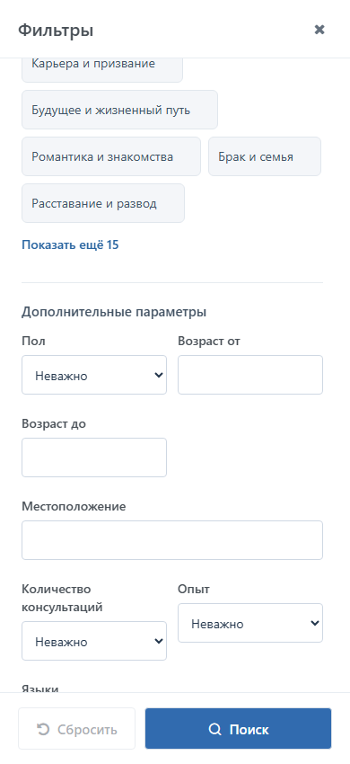
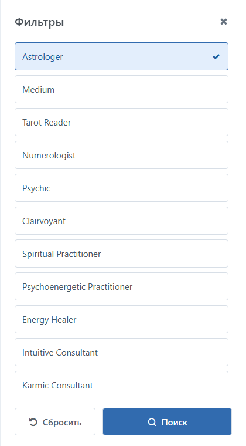
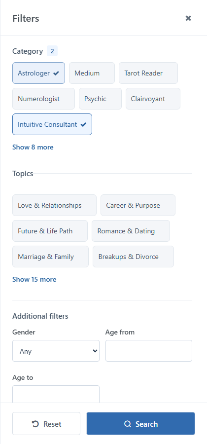
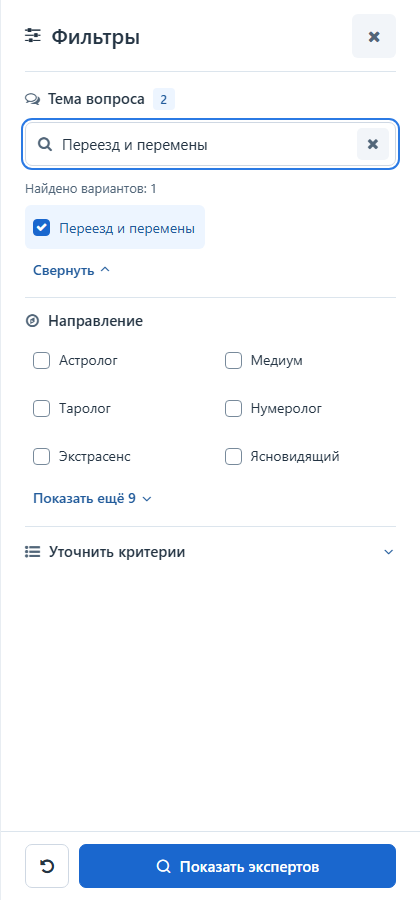
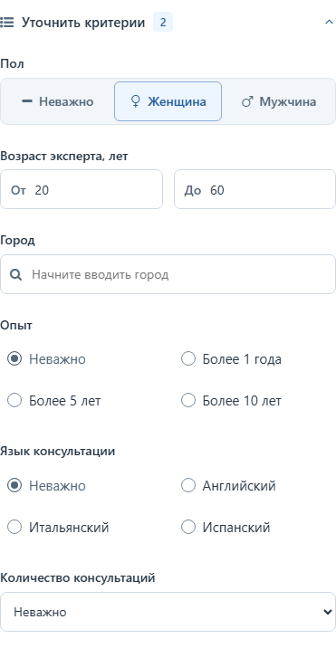
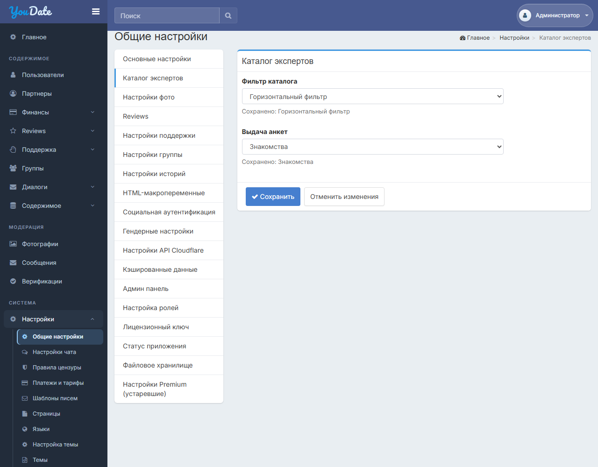
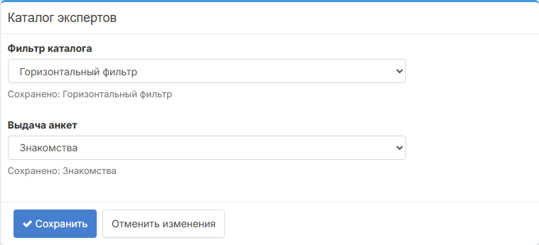
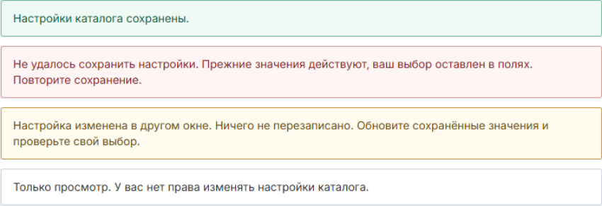
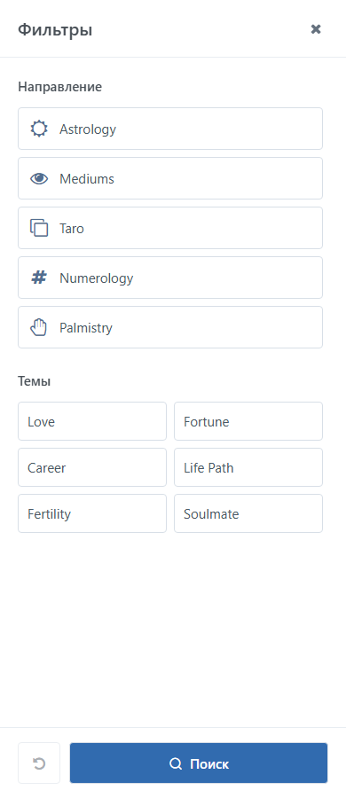

# Задача 1. Фильтр каталога экспертов

Редакция 03.11.2026, r13. Задание Игорю на разработку. Иллюстрации показывают проектируемый результат, а не уже внедрённую функцию.

## Что нужно сделать

В отдельной задаче подготовить боковую панель существующего поиска: посетитель выбирает доступные ему условия и применяет их кнопкой внизу. Текущая форма называется «Горизонтальный фильтр», новая панель — «Вертикальный фильтр». Администратор выбирает оформление фильтра независимо от шаблона выдачи анкет.

Задача включает панель и её подключение к действующему поиску и настройкам полей. Не заменять состав пользователей, серверный поиск, права, сортировку, счётчик или страницы собственным алгоритмом макета. Новые карточки и отдельная настройка гостевого online-режима — в задаче выдачи. Шапку, логотип, общее меню и другие разделы не переделывать.

Оба оформления фильтра используют одну и ту же действующую серверную выдачу и права. Установка файлов не включает новые варианты автоматически. Отдельный гостевой флажок из задачи выдачи применяется сервером независимо от оформления; в отсутствие настройки он выключен. Готовность одной задачи не заменяет приёмку другой.

## Как определить действующее поведение

До изменений Игорь фиксирует версию рабочего приложения и соответствующую ей исходную сборку для сравнения: проверяемый идентификатор ревизии, конфигурацию, роли и обезличенные тестовые данные. Если соответствие кода рабочей версии не установлено, это указывается как блокирующая зависимость для затронутых проверок; старый архив и этот макет не становятся эталоном автоматически. На согласованной тестовой среде старый и новый вариант сравнивают при одинаковых данных, настройках, роли и действиях. Рабочие настройки ради сравнения не переключают.

Приоритет такой: явно согласованное в этом ТЗ изменение представления и отдельная гостевая настройка; для остального — проверенное поведение исходной сборки и действующие серверные права. Справочная таблица ниже — подсказка для проверки, а не основание менять сайт. Если исходная сборка недоступна или сохранение её поведения вне согласованных изменений конфликтует с отдельным требованием либо серверным запретом, Игорь фиксирует расхождение и помечает зависимый пункт BLOCKED; не выбирает трактовку и не меняет несвязанный модуль самостоятельно. Остальные независимые части можно делать и проверять.

## Кто видит выдачу

**Гость** — посетитель без входа. **Клиент** — посетитель, вошедший в свой аккаунт. «В сети» означает online, «Занят» — busy, «Не в сети» — offline. Статус «В сети» не обещает немедленного ответа или консультации.

| Посетитель | Кого включать в карточки и число «Найдено» |
| --- | --- |
| Гость | Действующая гостевая выдача. При отдельно включённой настройке — только допущенные эксперты online |
| Клиент | Действующая авторизованная выдача; гостевая настройка её не ограничивает |
| Любая роль | Действующие настройки доступа, фильтры и права сайта; оформление не добавляет собственных ограничений |

Когда отдельная гостевая настройка включена, неизвестный статус не считать online. В остальных случаях шаблон не исключает анкеты из-за статуса и не меняет историю. Использовать подтверждённые источники экспертности и доступности; время последнего посещения не приравнивать к статусу консультации.

Для новой настройки задача выдачи подключает действующие серверные признаки экспертной анкеты и её публичного статуса. Пока хотя бы один источник не подтверждён, флажок недоступен, сервер отклоняет его включение, а штатная выдача и оба фильтра остаются работать; зависящая от него приёмка — BLOCKED. Документированное имя `profile.is_expert` служит ориентиром для поиска, а не доказательством текущей реализации.

Если настройка уже включена, а необходимый источник целиком недоступен, не выключать её и не возвращать обычную неограниченную выдачу. Показать штатную ошибку каталога; повтор использует те же ограничения. Неизвестный статус отдельной анкеты по-прежнему не считается online.

Один действующий серверный набор определяет карточки, число найденных и количество страниц. Переключение оформления не изменяет этот набор. Ограничение по новой гостевой настройке выполняется сервером до счётчика и страниц, а не скрытием карточек в браузере.

## Действующие настройки доступа

Сохранить существующие настройки в «Общие настройки»: «Скрыть каталог пользователей от гостей», «Скрывать пользовательские профили от гостей» и «Скрывать расширенные поля профиля от неавторизованных пользователей». При закрытом гостевом каталоге штатный вход обязателен до поиска, счётчика и страниц. Настройка профилей проверяется независимо: закрытый каталог не закрывает прямой профиль автоматически, а открытый каталог не гарантирует гостю вход в профиль. Для вошедшего пользователя эти три гостевые галочки сами по себе не отменяют обычные права и ограничения.

У полей профиля есть отдельные настройки видимости, показа только Premium, **«Поиск»** и **«Поиск (премиум)»**. Это не взаимозаменяемые права: панель получает от сайта разрешённые для поиска поля и их доступность, а карточка — отдельно разрешённые для показа значения. Не превращать настройку видимости профиля в автоматический запрет поиска. Нельзя полагаться только на отключение элемента в браузере: обработка запроса остаётся на действующем сервере.

В таблице «Да» означает включённую галочку. Это план проверки гостя по названиям настроек и старому локальному исходнику, а не доказанное поведение всех сочетаний текущего сервера. Последняя колонка относится к профилю; правила карточки проверяются отдельно.

| Скрыть каталог | Скрыть профили | Скрыть расширенные поля | Каталог гостя | Прямой профиль гостя | Расширенные поля профиля |
| --- | --- | --- | --- | --- | --- |
| Нет | Нет | Нет | Доступен по правам | Доступен по правам | По правам поля |
| Нет | Нет | Да | Доступен по правам | Доступен по правам | Скрыты |
| Нет | Да | Нет | Доступен по правам | Вход | Профиль закрыт |
| Нет | Да | Да | Доступен по правам | Вход | Профиль закрыт |
| Да | Нет | Нет | Вход | Доступен по правам | По правам поля |
| Да | Нет | Да | Вход | Доступен по правам | Скрыты |
| Да | Да | Нет | Вход | Вход | Профиль закрыт |
| Да | Да | Да | Вход | Вход | Профиль закрыт |

При закрытом профиле его поля гостю не показываются независимо от третьей галочки. После входа сайт заново определяет права уже авторизованного посетителя.

Восемь сочетаний трёх действующих настроек, два состояния нового гостевого флажка, две роли и четыре сочетания оформления входят в один общий набор проверок после внедрения. Человеку не нужно отмечать каждое сочетание отдельно: пять групп и общий результат находятся на листе «Доступ» в acceptance.xlsx. Макеты используют искусственные данные и не подключены к настройкам сайта.

## Поля из админки

Источник управляемых полей — «Настройки → Поля профиля». Для каждого поля сервер использует существующие признаки «Поиск» и «Поиск (премиум)», тип, порядок, переводы, значения и действующее право посетителя. Не считать авторизацию признаком Premium. Комбинации флажков и право отправить параметр трактовать через текущую реализацию приложения; если поле недоступно без Premium, сохранить существующий способ показать ограничение и предложение тарифа. Прямой запрос не должен обходить серверные права.

В старом локальном исходнике поле попадало в набор поиска при любой из двух галочек, а включённый признак Premium ограничивал применение поля без Premium. Это ориентир для проверки, не доказательство текущего production: отдельно проверить все четыре комбинации галочек и роли гость, Free и Premium на целевой версии.

На момент просмотра включены для поиска Areas, Specialization, Number of Consultations, My Experience и My Languages. Их набор может измениться администратором: новое разрешённое поле появляется в панели без правки шаблона, выключенное исчезает или блокируется по действующему правилу. Поля пола, возраста, географии и другие работающие условия прежнего поиска также сохраняются. В макете они показаны как синтетические примеры контролов; фактические виджеты, значения и семантику необходимо подключить из работающего приложения.

Поля направлений и тем, если они разрешены сайтом, занимают свои секции и не дублируются. В десктопной панели тема вопроса идёт перед направлением; раздел «Уточнить критерии» содержит остальные разрешённые поля. На телефоне сохраняются порядок и открытый раздел «Дополнительные параметры» из мобильного макета. Значения, число допустимых выборов и правила поиска берутся из действующей формы. Для нового типа поля используйте штатный виджет; если его нельзя подключить, поле не считать поддержанным и указать остаток.

Референс [панели Maktaro](https://maktaro.com//account/psychics.html): заголовок и закрытие, самостоятельные секции, подходящие списки/переключатели и фиксированные действия внизу. Это образец компоновки, не автоматическое добавление сортировки, рейтинга, статусов или иных функций. Для типа поля и допустимого числа значений использовать существующий контрол и семантику сайта; не навязывать «И» или «ИЛИ», новые диапазоны либо значения только из-за вида макета.

Значения берутся из текущих справочников. На проверенном сайте в них не найдены отдельные Palmistry, Fortune, Fertility и Soulmate; Specialization защищено от редактирования из-за других фильтров. Не добавлять, не подменять и не изменять ключи этих значений в рамках вёрстки. Отсутствующие пункты и новые правила поиска требуют отдельной согласованной задачи. Синтетические параметры макета не являются данными или разрешениями сайта.

## Как пользоваться панелью

1. Нажать «Фильтры». Открывается панель с уже применённым выбором. Список начинается сверху, клавиатурный фокус — на заголовке. Фон не прокручивается и не принимает действий, Tab и Shift+Tab остаются внутри.
2. Галочки меняют только черновик; карточки и число найденных пока прежние.
3. «Показать экспертов» на десктопе («Поиск» на телефоне) передаёт черновик существующему обработчику и закрывает панель после разрешённой отправки; переход выполняется по действующим правилам сайта. Если проверка отклонила значение, панель остаётся открытой, свёрнутый раздел с ошибкой раскрывается, фокус переходит к первому ошибочному полю, запрос не отправляется. Новых правил проверки значений не вводить.
4. Крестик, Escape и нажатие на фон закрывают без передачи черновика. Повторное открытие считывает текущее состояние существующей формы, а не отброшенный черновик.
5. «Сбросить» вызывает существующее действие сброса сайта и закрывает панель; состав сбрасываемых условий и возврат определяются текущей реализацией.

В длинных списках направлений и тем сначала показаны шесть вариантов и кнопка «Показать ещё» с количеством остальных. Кнопка раскрывает весь список; «Свернуть» возвращает компактный вид, не скрывая уже выбранные значения. Это изменение отображения, не ограничение доступных значений или числа выбранных пунктов.

На десктопе при раскрытии списка из 10 и более вариантов появляется поле «Найти тему» или «Найти направление». Ввод ищет по названиям доступных вариантов без учёта регистра, не меняет галочки и не запускает поиск экспертов. При отсутствии совпадений показать «Совпадений нет». Крестик и Escape очищают непустую строку; Enter в ней не применяет фильтр. Со свёрнутым списком поиск скрыт; при повторном раскрытии строка пуста. В обычных полях Escape закрывает подсказки раньше панели.

«Уточнить критерии» свёрнут при открытии. После выбора рядом с заголовком видно число дополнительных условий, ниже — их значения; обе границы возраста считаются одним условием. Пол, если доступны соответствующие три варианта, показывается сегментами с символами и подписями. Возраст — поля «От» и «До» с существующими границами и проверками. Город — штатный географический контрол; для свободного поля с разрешённым справочником доступны подсказки и плейсхолдер «Начните вводить город». При отсутствии справочника сохраняется штатное поле. Подсказки не извлекаются из закрытых анкет. Короткие списки опыта и языка с одиночным выбором (до пяти вариантов с «Неважно») видны сразу; при большем наборе или ином типе используется штатный контрол. Число консультаций остаётся числом, не рейтингом; новые пороги и рейтинг не добавляются.

После закрытия фокус возвращается к «Фильтры». Отмена панели сохраняет горизонтальную позицию мобильной ленты карточек; поиск и смена страницы показывают начало новой выдачи.

Применённые условия видны над результатом только при выбранном вертикальном фильтре. Их отображение, удаление и «+N» относятся к этой задаче; при горизонтальном фильтре остаются штатные представление условий и управление ими. Задача выдачи собственной панели или обработчика не создаёт, в том числе при отдельной установке. Одно условие — одно логическое поле существующей формы вместе со всеми его выбранными значениями или границами диапазона; возраст от/до — одно поле, география с её зависимыми контролами — одно поле. Заголовок и значения берутся из текущих локализованных данных. Показывать поля в порядке исходной формы, значения внутри поля — в порядке её списка. Например, два выбранных направления дают одно условие «Направления: A, B», а не два счётчика. Значение по умолчанию показывается, если по правилам исходной формы оно фактически ограничивает поиск; пустое или означающее «любое» не показывается.

Крестик возвращает все значения только этого поля к значениям штатного сброса и вызывает существующий обработчик поиска. Если поле уже равно ограничивающему значению штатного сброса, показывать условие без неработающего крестика. Другие поля не очищать; если существующий обработчик требует сбросить зависимое поле, сохранить именно это штатное поведение. На телефоне показать первое активное поле и «+N», где N — число остальных активных полей; нажатие открывает полный выбор в панели. Пустые поля в число не входят.

## Обновление, ссылки и возврат

Прямая ссылка, обновление, «Назад» и «Вперёд» используют действующую политику сайта для адреса, сессии, условий и страницы; сервер заново проверяет текущую роль и доступность. Черновик панели не подменяет применённый поиск. Не добавлять собственные правила хранения или восстановления параметров.

Если запрошенной страницы больше нет или условия меняются, использовать существующее поведение приложения. Счётчик и пагинация должны соответствовать ответу сайта; демонстрационная обработка страниц не является новым серверным требованием.

Корректные старые ссылки и сохранённые параметры продолжают работать. Не терять прежние условия пола, возраста, географии и другие параметры при отправке новой формы; отображать и удалять их по действующим правилам приложения. Панель не подменяет один параметр другим.

Просмотр и смена оформления не вводят собственную политику сохранения: сайт продолжает использовать свои действующие URL, сессию и предпочтения. Старая локальная версия сохраняла параметры поиска в сессии; актуальное поведение необходимо сверить, не заменяя его предположением.

## Ожидание, пустота и ошибка

| Состояние | Что видит и может сделать посетитель |
| --- | --- |
| Загрузка | Использовать существующее состояние приложения; старый ответ не выдаётся за результат нового запроса |
| Нет совпадений | Существующее пустое состояние и доступное изменение или сброс условий; не подставлять другую выдачу |
| Ошибка | Использовать существующее состояние ошибки; не называть ошибку результатом «0» |
| Повтор | Использовать действующий механизм приложения, не вводить новую политику истории |
| Некорректная ссылка | Существующий безопасный сценарий приложения, без обхода доступа |

Проверка параметров и доступа остаётся на сервере. Поведение номера страницы и истории сохраняется по текущему приложению.

Для проверки неуспешного поиска использовать пример: исходная форма и результаты содержат A, в панели выбрано B и запрос завершился ошибкой. Ошибка не означает успешных результатов B. При повторном открытии показать фактическое состояние формы после ошибки в исходной сборке для тех же условий: если она сохранила B — показать B, если вернула A — показать A. Повтор и обновление используют тот же обработчик и состояние, что исходная сборка; панель не записывает своё отдельное «успешное» состояние. Если состояние исходной сборки не удаётся установить, этот сценарий BLOCKED, а не выбранное наугад правило.

Если штатный интерфейс после ошибки оставляет предыдущие результаты A, обозначить их как предыдущие и показывать рядом только достоверные условия A, а не выдавать условия B за применённые к ним. До успешного запроса удаление условий у предыдущего ответа недоступно; изменить поиск можно в форме. Если приложение не сохраняет результаты A, не добавлять ради панели новый кэш: показывается его действующее состояние ошибки, а выбранные условия не называются успешным результатом.

[Макет ошибки поиска](../demo/catalog-filter.html?preview=1&searchFailure=1): выбрать условие и нажать «Поиск». В этом примере прежняя выдача убирается, а ошибка не превращается в нулевой результат.

## Где и как настраивать фильтр

В действующей админке открыть **«Настройки → Общие настройки»**. Внутри этой страницы есть вертикальное меню, начинающееся с «Основные настройки» и «Настройки фото». **Добавить новый пункт «Каталог экспертов» сразу после «Основные настройки», перед «Настройки фото».** Сейчас этого подраздела нет; это заданное место нового добавления. Главное левое меню админки не менять.

В новом подразделе одна форма «Каталог экспертов». Использовать существующие шрифты, колонки, белый блок формы, подписи, выпадающие списки и кнопки админки. Рисунок 3 показывает точную целевую форму крупно.

Макет формы: [русский](../admin.html?lang=ru) и [английский](../admin.html?lang=en). Это локальная демонстрация, не действующая админка.

| Поле | Варианты и назначение |
| --- | --- |
| Фильтр каталога | «Горизонтальный фильтр» — существующая форма поиска; «Вертикальный фильтр» — боковая панель из этого ТЗ |
| Выдача анкет | «Знакомства» — существующий шаблон выдачи; «Эзотерика» — новый шаблон с карточками экспертов. Поле приведено для полного контекста; его подключение относится к задаче выдачи анкет |

Под каждым выбором «Сохранено: …». **«Сохранить»** записывает изменённые поля оформления. **«Отменить изменения»** возвращает последние сохранённые значения. По умолчанию: «Горизонтальный фильтр» и «Знакомства». Установка файлов не меняет сохранённые настройки.

Форма оформления на рисунке показана, когда обе задачи установлены. Первая поставка создаёт подраздел «Каталог экспертов» и его форму, вторая добавляет свой выбор. Если установлен только фильтр, выбор выдачи недоступен; если только выдача, недоступен выбор фильтра. Неподключённое поле не должно сохраняться прямым запросом. Ранее сохранённые значения не перезаписываются. При раздельной сдаче остальные сочетания фиксируются как NOT_RUN.

**Гостевая выдача настраивается отдельно.** Задача выдачи добавляет флажок «Показывать гостям только экспертов онлайн» в существующие **«Общие настройки → Основные настройки»**, сразу под «Скрыть каталог пользователей от гостей». Использовать штатное сохранение этой страницы; в «Каталоге экспертов» флажок не дублировать. По умолчанию он выключен.

Если каталог скрыт от гостей, новый флажок недоступен с пояснением «Не применяется, пока каталог скрыт от гостей». Сохранённое значение остаётся прежним, даже если посетитель отправит значение отключённого поля прямым запросом. При открытии каталога оно снова применяется. Пока не подтверждены источники статуса и экспертности, включение нового ограничения недоступно. Сохранение гостевой выдачи не меняет оформление, а выбор оформления не меняет гостевые настройки.

Макет «Основные настройки»: [RU](../admin-general.html?lang=ru), [EN](../admin-general.html?lang=en).

| Фильтр каталога | Выдача анкет | Что получает посетитель |
| --- | --- | --- |
| Горизонтальный фильтр | Знакомства | Существующие форма и шаблон выдачи с действующими настройками и правами |
| Вертикальный фильтр | Знакомства | Новая боковая панель и существующий шаблон выдачи |
| Горизонтальный фильтр | Эзотерика | Существующая форма и новый шаблон с карточками экспертов |
| Вертикальный фильтр | Эзотерика | Новая боковая панель и новый шаблон с карточками экспертов |

Названия «Знакомства» и «Эзотерика» обозначают только оформление. При одинаковых настройках они получают одну действующую выдачу; прежние обычные анкеты не исключаются только выбором шаблона. Сохранение одного поля не меняет другой выбор и гостевые настройки. Кнопка этой формы записывает только изменённые поля; несколько изменений применяются вместе либо отклоняются целиком. Следующий запрос использует сохранённые значения; обновление админки читает их, не черновик.

| Событие | Ожидаемое поведение |
| --- | --- |
| Успех | «Настройки каталога сохранены». Подписи сохранённых значений обновлены |
| Подтверждённый отказ | «Не удалось сохранить настройки. Прежние значения действуют, ваш выбор оставлен в полях. Повторите сохранение». Черновик не потерян |
| Ответ потерян | «Результат сохранения пока не подтверждён. Проверьте сохранённые настройки перед повтором». До успешного чтения сохранённых значений повторная запись недоступна; при ошибке чтения неопределённость и черновик сохраняются |
| Два окна меняют разные поля | Применяются только изменения каждого окна, соседний чужой выбор не затирается |
| Два окна меняют одно поле от прежнего состояния | Второе сохранение сообщает конфликт и ничего не перезаписывает; видно текущее значение и свой черновик. При обновлении основы сохраняются только поля, изменённые в этом окне; остальные получают актуальные значения. После проверки сотрудник явно сохраняет только свои изменения |
| Нет права изменения | Только разрешённый существующими правами просмотр; поля и сохранение недоступны, видна причина. Прямую запись сервер также отклоняет |

Во время сохранения исключить повторную запись. Если ответ потерялся, сначала перечитать результат, не повторять вслепую. В действующем журнале фиксировать сотрудника, время, поле, прежнее/новое значение. Новую роль не вводить.

Макет неизвестного результата сохранения: [русский](../admin.html?scenario=unknown&lang=ru), [английский](../admin.html?scenario=unknown&lang=en). Изменить поле, нажать «Сохранить» и проверить сохранённые настройки; первая проверка показывает пример ошибки чтения, повторная — восстановление.

Возврат к варианту «Горизонтальный фильтр» не удаляет вертикальный фильтр, профили, предпочтения, избранное или переписки, не меняет цены и не запускает консультацию. Горизонтальную форму сохранить в приложении как рабочую; демонстрационный HTML её не заменяет.

## Внешний вид и доступность

До 575 CSS px панель занимает весь экран. От 576 px — справа, ширина до 420 px; для точного указателя при ширине 576–767 px — 396 px. На сенсорном устройстве при высоте окна до 500 CSS px панель занимает всю доступную область и в горизонтальной ориентации. На десктопе при высоте до 680 px уменьшить вертикальные отступы заголовка и действий, не уменьшая сами цели нажатия. Прокручиваются только параметры; заголовок и действия остаются видны. Горизонтальной прокрутки панели нет.

Использовать шрифт и палитру темы YouDate: синие акценты, нейтральные поля, видимый фокус; учитывать светлую и тёмную темы приложения. Темы и направления на десктопе — строки с чекбоксами в двух колонках; при нехватке ширины, в том числе из-за увеличенного текста, — в одной. Не обрезать подписи и не уменьшать шрифт пропорционально экрану. Основные цели touch не менее 48×48 CSS px, мыши 44×44. Иконки фильтра, закрытия и сброса имеют доступные имена; кнопка применения сохраняет подпись.

Проверить ширины 320, 360, 375, 390, 480, 575, 576, 768, 992, 1280, 1440 CSS px; горизонтальные 667×375 и 844×390; русский/английский, текст 200%, уменьшенное движение и клавиатуру. Существующие оболочка и пользовательская тема не изменяются; светлая клиентская оболочка в макете — пример. Новые поля и сообщения админки также локализуются штатной системой. Новые стили действуют только в собственном блоке, не меняя общие ресурсы сайта.

## Компактная проверка двух задач

Пять групп ниже выполняются **одним общим прогоном для обеих задач**, когда реализованы обе; если готова только одна, проверить применимую часть и явно указать остаток. Это не пять замен всем остальным критериям: 14 пунктов своей задачи сохраняются, а одна выполненная проверка может подтверждать несколько пунктов по ссылке на одно доказательство.

| Группа | Что проверить | Ожидаемый результат |
| --- | --- | --- |
| A1 | Три настройки доступа: каталог, прямой профиль и расширенные поля; гость и вошедший пользователь | Действующие ограничения каждого входа и права полей соблюдены; доступ к каталогу не подменяет проверку профиля |
| A2 | Гостевой online-флажок выключен и включён; online, busy, offline, неизвестный статус и обычные анкеты | Флажок ограничивает только гостевой каталог при включении; счётчик и страницы соответствуют выдаче |
| A3 | Оба фильтра и оба шаблона выдачи при неизменных данных и настройках | Четыре сочетания не меняют состав, порядок, права и правила существующих действий; настройки сохраняются независимо |
| A4 | Все четыре сочетания обычного и Premium-поиска, дополнительные типы полей; гость, Free и Premium | Поля и обработка соответствуют действующим настройкам и правам; прямой запрос не обходит серверные ограничения |
| A5 | Профиль и разрешённые действия, состояния ошибки, клавиатура и адаптивность | Выбранная анкета и действующие действия сохраняются; интерфейс читаем, а ошибка не выдаётся за успех |

На изолированных тестовых данных собрать **один параметризованный прогон** по комбинациям настроек и представлений, по возможности штатными средствами проекта. В нём доступны все 128 комбинаций семи двоичных параметров; выполнять их в памяти или на подготовленных фикстурах, без 128 переключений рабочей админки и без нагрузочного теста. Проверяется реальная логика приложения, а не её имитация. Набор параметров и генератор — в `integration/qa/`; они лишь готовят случаи, а не проверяют сайт. Поля Premium, статусы и остальные риски из групп проверяются отдельно в том же наборе. Если не удаётся подтвердить независимость уровней или какая-то комбинация не выполнена, указать точный остаток, а не засчитывать полное покрытие.

Отдельно провести минимальный сквозной проход по реальным ролям на согласованной тестовой среде и автоматический проход адаптивности; не повторять один и тот же сценарий вручную для каждого сочетания. Поддельные права или демонстрационные данные не заменяют серверную проверку. Настройки production не переключать. В отчёте по каждой группе указать покрытие, результат и ссылку на факты; при частичном выполнении перечислить непроверенные условия. Ни одна группа не становится PASS только из-за наличия генератора.

## Приёмка задачи 1

Каждая строка — проверка после внедрения. Сейчас все строки «Не проверено». Успех локального макета не означает успеха серверной реализации.

| № | Условия и действие | Ожидаемый результат |
| --- | --- | --- |
| 1 | Открыть старую ссылку с возрастом, географией и дополнительным полем; переключить оформление и сбросить | Сохраняются действующие параметры, их смысл и прежняя логика сброса |
| 2 | Изменить доступные поля «Поиск» и «Поиск (премиум)» в тестовой среде; открыть панель гостем, Free и Premium | Набор, тип, порядок и доступность соответствуют действующей конфигурации и правам; прямой запрос не обходит их |
| 3 | Сопоставить выбор нескольких значений с действующим поиском | Переданы корректные параметры и сохранён прежний результат; новая вёрстка не меняет сочетание условий |
| 4 | Включить дополнительное поле другого типа; выбрать и применить его | Поле появляется в разделе дополнительных полей в порядке исходной формы, управляется клавиатурой и использует действующий обработчик |
| 5 | Применить поиск; снять условие со второй страницы; обновить, вернуться назад/вперёд; открыть исчезнувшую страницу | Сохранены действующие правила адреса, сессии и пагинации; выбор, счётчик и карточки согласованы |
| 6 | На исходной и новой форме выполнить A → B → ошибка, открыть панель и повторить | После ошибки обе формы показывают одинаковые сохранённые условия; повтор работает штатно, ошибка не выдаётся за пустой успешный результат |
| 7 | В «Основных настройках» включить ограничение, скрыть каталог и снова открыть его | Флажок расположен под «Скрыть каталог пользователей от гостей»; закрытие имеет приоритет и не сбрасывает значение. После открытия видны только допущенные online-эксперты; клиент не ограничен |
| 8 | Подменить параметры в прямой ссылке | Нет обхода доступа, утечки или ложного успеха; понятно исправление/сброс |
| 9 | Сохранить «Вертикальный фильтр», обновить, вернуть «Горизонтальный фильтр»; попробовать запись без права | Сохранение читается повторно и записано в журнале; «Выдача анкет» не меняется; запрещённая запись отклонена |
| 10 | Проверить размеры, RU/EN, темы, текст 200% и клавиатуру; раскрыть длинный список и найти вариант | Панель читаема, без перекрытий и горизонтальной прокрутки. Поиск вариантов не меняет галочки или выдачу, выбранное видно после сворачивания |
| 11 | Сравнить обычные и экспертные анкеты в обоих оформлениях при одинаковых настройках | Набор, порядок, счётчик и страницы одинаковы; новый флажок влияет только при явном включении |
| 12 | Изменить галочки и дополнительные условия, свернуть блок; закрыть панель; проверить применение и сброс | В свёрнутом блоке видны значения; отмена не отправляет черновик, применение и сброс вызывают штатные действия; фокус возвращается к «Фильтры» |
| 13 | Сопоставить реальные поля и справочники; проверить защищённый Specialization | Только действующие разрешённые значения; защищённые ключи не меняются, отсутствующие понятия не подменяются |
| 14 | Четыре сочетания шаблонов, три существующие гостевые настройки и новый флажок; права полей, кэш, ошибка и два окна | Доступ и поиск соблюдают действующие права; настройки независимы, конфликт без затирания; прежние данные сохранены |

В рамках пунктов 5, 6, 12 и 14 также проверить невалидное поле до отправки; ошибку B при предыдущем результате A; установленную только задачу выдачи; конфликт двух окон, когда второе изменило ещё одно поле; потерянный ответ сохранения и неуспешное первое чтение. Для горизонтального фильтра новые индикаторы вертикального не появляются.

Игорь передаёт реализованные страницы, изменённые файлы, заполненную приёмку с доказательствами и остатком. Далее QA/PM проверяет согласованную среду. Пакет сам не разрешает менять рабочие настройки, проводить платежи или развёртывать production.

## Техническое приложение

`integration/filter/` — визуальный пример, не готовый адаптер текущего серверного поиска. До подключения нужно связать его с действующими виджетами всех разрешённых полей, типами, правами Premium и существующими параметрами; не отправлять демонстрационные имена и значения на реальный сервер. Новый CSS ограничен `.cl-catalog-filter`; подключать после штатных стилей, не дублировать обработчики при PJAX. `integration/admin/catalog-settings.html` — форма, `catalog-settings.css` — её изолированные стили. `admin.html` — локальный макет, не настройки сайта; `admin-shell/` не переносить как глобальные стили.

Целевой новый подраздел: предлагаемый маршрут `admin/settings/catalog`, категория `catalog`, пункт в действующем `settings/_layout.php`; актуальный backend нужно сверить. Предлагаемые независимые значения: `catalog.filter_version`, `catalog.cards_version` и boolean `catalog.guest_experts_online_only`, по умолчанию `1`, `1`, `false`. Переиспользовать существующие ключи, права, защиту формы и журнал; изменённые поля сохранять атомарно с проверкой ревизии. На маршруте каталога редактируются только два ключа оформления. Boolean гостевой выдачи добавляется в штатную форму «Основные настройки» рядом с `Settings[siteHideDirectoryFromGuests]`. При сохранении проверять итоговое значение скрытия каталога на сервере: при закрытом каталоге прежний boolean гостевой выдачи сохраняется; отключённое поле или его отсутствие не трактовать как false. Публичный URL настройки не меняет.

Поиск использует действующий GET/PJAX либо принятый аналог без обязательного нового API/схемы БД. `integration/shared/_versionSelection.php` — схема независимых представлений, не готовый сервер. Демо содержит искусственные данные и локальные действия; его контроллер/вход/сообщения не переносить вместо рабочих модулей. `CODEX.html` и `CODEX.md` производны от этого ТЗ; противоречие требует исправить комплект.
