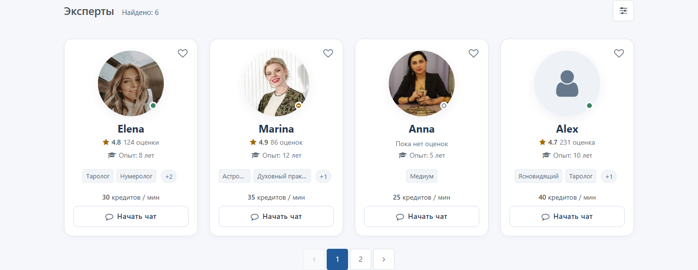
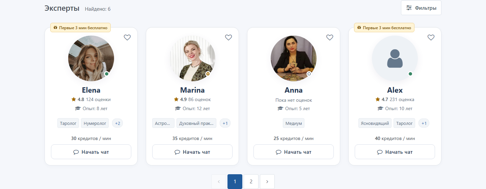
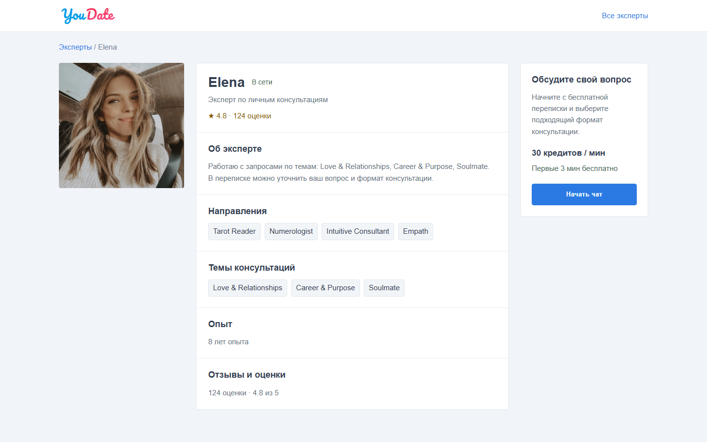

# Задача 2. Выдача анкет и бесплатный чат

Редакция 03.11.2026. Задание Игорю на разработку. Иллюстрации — проектируемый результат на искусственных данных, не внедрение на рабочем сайте.

## Что нужно сделать

Внедрить шаблон выдачи «Эзотерика» с карточками профилей, сохранив работающий шаблон «Знакомства». Посетитель открывает профиль или использует доступные ему действующие действия сайта. Администратор выбирает «Выдача анкет» отдельно от фильтра; выбор шаблона меняет только внешний вид.

Нужны варианты оформления для гостя и авторизованного посетителя, сетка и мобильная лента. Каждому показывать те данные и действия, которые уже разрешены ему сайтом. Форма поиска — отдельная задача. «Эзотерика» работает с обоими вариантами фильтра. Шапку, логотип, меню, личную страницу, другие страницы и работающий чат этой задачей не переделывать.

Оба шаблона получают одну и ту же выборку, порядок, счётчик, страницы и права от действующего приложения. Возврат к «Знакомствам» сохраняет прежнюю выдачу пользователей, включая обычные анкеты, если они доступны по текущим правилам. Установка шаблона сама не меняет поиск, статусы, фильтры, переписку, платные действия или настройки. Для отдельно согласованного ограничения гостей добавляется отдельная настройка ниже; до её включения поведение не меняется.

## Гость и авторизованный посетитель

**Гость** не вошёл в аккаунт, **клиент** вошёл. Состав выдачи и доступные действия определяются действующими правилами соответствующей роли и настройками сайта. Сам шаблон не отбрасывает обычных пользователей, занятых или отсутствующих экспертов и не придумывает неизвестный статус. «В сети» не гарантирует немедленного ответа.

Макеты для разработки: [выдача гостя](../demo/catalog-filter.html) и [выдача авторизованного клиента](../demo/catalog-filter-auth.html). Оба содержат готовую HTML-разметку и стили, работают на искусственных данных и не подтверждают работу сервера.

| Сценарий | Гость, без входа | Авторизованный клиент |
| --- | --- | --- |
| Выборка и счётчик | Действующая гостевая выборка и настройки; новая галочка ограничивает её только при включении | Действующая выборка и права клиента; гостевая галочка на неё не влияет |
| Карточка и статус | Разрешённые данные и подтверждённый статус; неизвестное не выдумывать | Те же правила действующего приложения для этого посетителя |
| Сердце | Только действие и вход, разрешённые существующей функцией | Существующая симпатия или избранное с их прежним смыслом |
| Начать чат | Штатный вход и действующие ограничения сайта | Штатный чат выбранного профиля и его существующие ограничения |
| Отмена и возврат | Сохранить поведение действующего входа и возврата | Сохранить действующий контекст и историю |

Гостевое и клиентское поведение не сводится к цвету оболочки. При одинаковых настройках и одном посетителе переключение шаблона не меняет ни одну возвращённую анкету или страницу. Дополнительное ограничение для гостей включается отдельно и действует одинаково в обоих шаблонах, но не меняет правила прямого профиля.

Новая настройка **«Показывать гостям только экспертов онлайн»** по умолчанию выключена. При включении сервер показывает в каталоге гостю только допущенные экспертные профили с подтверждённым состоянием «В сети», не занятых и не отсутствующих; применяет это до счётчика и страниц. Неизвестный статус не считать online. Для вошедших состав не меняется. Выключение возвращает действующую выдачу по её обычным правилам, включая обычные анкеты. Нужны подтверждённые источники признака эксперта и статуса: не заменять статус временем последнего посещения. Пока источники не установлены, не включать и не считать настройку внедрённой.

Это новая самостоятельная настройка, а не существующая опция пользовательского фильтра «Пользователи онлайн». Она не переключается вместе с шаблоном, не меняет другие страницы и не ограничивает прямой профиль или чат сама по себе.

## Действующие настройки доступа

Новая выдача использует существующие настройки в «Общие настройки» и существующие правила полей. Она не создаёт второй источник прав и не меняет текущие значения при установке или переключении шаблона. Сначала сервер определяет посетителя и действующие права, затем применяет настройки; ограничения поля, тарифа, скрытого профиля и другие штатные запреты сохраняются.

| Действующая настройка | Что требуется от новой выдачи |
| --- | --- |
| Скрыть каталог пользователей от гостей | Гостю закрыт каталог и его выдача, фильтрация, число и страницы; использовать штатный вход. Прямой профиль проверяется независимо |
| Скрывать пользовательские профили от гостей | Гость не открывает личную страницу, в том числе напрямую и по фото, имени или «+N»; использовать штатную авторизацию. Если каталог разрешён, доступные карточки остаются в нём |
| Скрывать расширенные поля профиля от неавторизованных пользователей | Соблюдать действующую серверную обработку расширенных полей профиля; не расширять её на другие поверхности без отдельного решения |

У каждой дополнительной характеристики уже есть отдельные параметры видимости, показа только Premium и поиска. Проверять их через действующие серверные механизмы для конкретного поля и посетителя; право поиска не считать автоматически правом показа и наоборот. Цена, рейтинг, фотография и описание не объявляются расширенными полями автоматически: проверить их фактический источник и применимые правила в приложении. Клиенту не обходить тарифные, персональные и другие ограничения только из-за факта входа.

Ниже «скрыть» означает включённую галочку. Это план проверки гостя по названиям настроек и старому локальному исходнику, а не доказанный результат всех сочетаний на текущем сервере. Колонка полей относится к профилю; видимость в карточке определяется существующими правами конкретного поля.

| Скрыть каталог | Скрыть профили | Скрыть расширенные поля | Каталог гостя | Прямой профиль гостя | Расширенные поля профиля |
| --- | --- | --- | --- | --- | --- |
| Нет | Нет | Нет | Доступен по правам | Доступен по правам | По правам поля |
| Нет | Нет | Да | Доступен по правам | Доступен по правам | Скрыты |
| Нет | Да | Нет | Доступен по правам | Вход | По правам поля |
| Нет | Да | Да | Доступен по правам | Вход | Скрыты |
| Да | Нет | Нет | Вход | Доступен по правам | По правам поля |
| Да | Нет | Да | Вход | Доступен по правам | Скрыты |
| Да | Да | Нет | Вход | Вход | По правам поля |
| Да | Да | Да | Вход | Вход | Скрыты |

Для вошедшего пользователя гостевые галочки сами по себе не являются запретом; остальные права и ограничения сохраняются. Карточка получает от сервера только значения и действия, разрешённые действующей политикой для этой поверхности и посетителя; не считать CSS защитой. Право видеть поле и право искать по нему могут настраиваться отдельно. Не запрещать поиск только потому, что поле скрыто в профиле, и не менять действующую область фильтра без отдельного решения.

Настройки и права проверяются действующим сервером при каждом соответствующем запросе; шаблон не обходит их и не раскрывает данные другого посетителя из кэша. Макеты используют искусственные данные: флажок в макете админки влияет только на демонстрационную выборку этого браузера, а не на сайт и не доказывает серверную защиту.

## Состав и действия карточки

Перенести композицию рисунка 1. Пример не является перечнем скрываемых полей: возраст, город, страна, биография и другие характеристики выводятся или не выводятся по действующей конфигурации и правилам сайта. Шаблон должен иметь место для дополнительных разрешённых полей и не удалять их из анкеты или других страниц.

| Элемент | Содержание и действие |
| --- | --- |
| Фото и имя | Разрешённые данные этой анкеты. При доступном штатном переходе оба открывают тот же профиль; при отсутствии маршрута не создавать пустую ссылку. Если фото нет — нейтральная заглушка |
| Сердце | Справа сверху, только существующее действие и его действительный смысл: симпатия либо избранное. Не превращать одно в другое; состояние и доступное имя приходят от сайта |
| Статус на портрете | «В сети»: зелёный заполненный; «Занят»: янтарный с минусом; «Не в сети»: полый серый. Название доступно при наведении, фокусе и нажатии, не только цветом |
| Рейтинг | Существующий компонент, оценка и число оценок. Не называть их числом текстовых отзывов. Нажатие ведёт к штатному разделу отзывов |
| Оценок нет / рейтинг выключен | При разрешённом показе без оценок — «Пока нет оценок». При выключенном показе рейтинга нет, без ложного нуля |
| Опыт | Реальный публичный стаж; пустое значение не заменять выдуманным |
| Направления | До двух меток, затем ссылка «+N» с числом остальных. Она открывает личную страницу этого эксперта, как его фото и имя; карточка не раскрывается и не меняет высоту |
| Цена | Только существующая разрешённая цена и единица. Если данных или разрешения нет — не показывать цену и не придумывать условия |
| Бесплатное начало | Только если действительно применимо к посетителю. Гостю не обещать персональные минуты с неизвестным правом |
| «Начать чат» / Start chat | Существующее действие чата для выбранной анкеты, только когда оно разрешено сайтом; само оформление не меняет его условия |

Другие существующие разрешённые направления не исчезают из карточки из-за отсутствия в новом фильтре. Для обычной анкеты или незаполненного поля не придумывать экспертные данные, цену, рейтинг или кнопки. Внутренние идентификаторы и сведения оператора клиенту не раскрываются. Значения в демо не являются рабочими настройками.

Фото, имя и «+N» ведут к одной существующей странице выбранного профиля, если переход разрешён. Сердце, рейтинг и чат — отдельные действующие компоненты. Не делать всю карточку ссылкой с вложенными кнопками и не подменять штатный результат действия. Просмотр профиля и отзывов не создаёт консультацию. Выдуманные текстовые отзывы не показывать.

## Личная страница эксперта

Профиль помогает посетителю понять, подходит ли ему эксперт, и начать общение. Это полноценная страница, не всплывающее окно. Фото, имя и «+N» из новой карточки ведут к одному профилю именно выбранного эксперта: при запрете гостевого просмотра используется штатный сценарий сайта. В профиле видны только разрешённые этому посетителю направления и темы. При возврате в каталог сохраняется действующее поведение сайта; права проверяются повторно.

Использовать существующую страницу профиля проекта; не менять её состав, права, дизайн и логику этой задачей. Пожелание сделать её продающей страницей консультации сохраняется для отдельной задачи: демонстрация ниже не внедряет изменения в действующий профиль. Не выдумывать биографию, отзывы, цену или обещание результата.

Профиль и чат доступны по действующим правилам сайта. Гость проходит штатную авторизацию, когда действие её требует; клиент использует существующий чат выбранной анкеты. Шаблон не запускает оплату самостоятельно и не меняет порядок работы существующего модуля консультаций.

[Демонстрационный профиль Elena](../demo/profile-preview.html?id=demo-elena&audience=guest) показывает полный переход на искусственных данных. Он иллюстрирует наполнение и навигацию, а не заменяет рабочую страницу и не утверждает новый утверждённый дизайн.

## Выдача на компьютере и телефоне

Заголовок, «Найдено», условия, карточки и страницы относятся к одному поиску. От 576 CSS px две колонки, от 992 три, от 1200 четыре.

До 575 px — горизонтальная лента карточек текущей страницы с нативным свайпом. При двух и более карточках ширина каждой до 300 CSS px; на узком экране оставить 36 px для продолжения, промежуток 12 px. Единственная карточка — исключение: полная ширина ленты, даже больше 300 px, без места для несуществующего продолжения. Без автопрокрутки, зацикливания и дублей.

Ниже отдельная пагинация «Страница N из M», не счётчик слайдов; при одной странице её нет. На самой области ленты стрелки и Home/End перемещают карточки, но не перехватывают клавиши внутри кнопок. Tab достигает всех действий.

Футеры соседних карточек выровнены. Длинные имена не закрывают цену и кнопку. В карточке можно сократить длинные метки многоточием; доступность полных названий на странице определяется правами сайта. Без дополнительных направлений длинные первые две метки переносятся сразу. «+N» — доступная с клавиатуры ссылка, а не раскрывающийся список. Подсказка статуса закрывается Escape/нажатием вне, фокус возвращается к вызвавшему элементу.

Портрет 136×136 CSS px, на телефоне 116×116; имя на телефоне 20/25 px. Отступы карточки на телефоне: сверху 20 px, по бокам 18 px, снизу 16 px. Сохранить принятые радиусы карточки 18 px и кнопки 10 px. Белая карточка, контурная кнопка в покое; hover только с настоящим указателем, без изменения геометрии. На touch первое нажатие выполняет действие. Бейдж сверху не закрывает лицо, сердце и соседей. Шрифт не уменьшается пропорционально экрану.

Проверить ширины 320, 360, 375, 390, 480, 575, 576, 768, 992, 1280, 1440 CSS px; горизонтальные 667×375 и 844×390; русский/английский, текст 200%, уменьшенное движение и клавиатуру. Сохранить темы гостя и клиента, доступные имена и видимый фокус. Новый CSS ограничен контейнером выдачи; оболочку не менять.

## Загрузка, ошибка и возврат

Показывать существующие состояния загрузки, пустоты и ошибки с действующими действиями сайта. Не считать ошибку нулевым результатом и не подставлять другие анкеты. Шаблон не меняет серверный запрос, счётчик, сортировку или правила сброса.

Из профиля/чата и через «Назад»/«Вперёд» сохранить действующее поведение восстановления параметров, сортировки, языка и страницы; права определяет сайт. Не вводить новую политику истории или сохранения предпочтений только из-за смены шаблона.

Открытие и отмена фильтра сохраняют горизонтальное положение ленты; поиск и смена страницы возвращают начало. Завершившийся запрос не перехватывает фокус у посетителя, уже перешедшего к другому действию. Смена оформления карточек не меняет состав, порядок, страницу, выбранного эксперта или смысл условий.

## Что происходит после «Начать чат»

Кнопка передаёт выбранный профиль в существующий вход чата. Она не создаёт новую систему переписки, не назначает другого эксперта и не изменяет правила создания или продолжения диалогов. Открытие не отправляет сообщение от имени клиента. Бесплатное общение и платная консультация остаются под управлением существующего модуля и его настроек.

| Ситуация | Ожидаемое поведение |
| --- | --- |
| Гость нажал чат | Действующий вход/регистрация и сохранение контекста, если это поддерживает сайт; после входа действующие проверки |
| Гостевая настройка online выключена | Шаблон не скрывает занятых, отсутствующих или обычные анкеты самостоятельно |
| Гостевая настройка online включена | В каталоге гостя только допущенные эксперты с подтверждённым online; прямой профиль проверяется отдельно |
| Клиент, эксперт в сети, занят или не в сети | Действующий чат доступен при выполнении остальных правил сайта; занятость не обещает немедленного ответа |
| Нет права писать или исчерпан лимит | Штатный отказ, ограничение или предложение сайта; шаблон не обходит его |
| Профиль стал недоступен | Действующее безопасное состояние сайта без подмены выбранного профиля |

При отмене входа, ошибке и просроченной сессии использовать действующий сценарий сайта. Контекст выбранной анкеты и безопасный внутренний возврат не подменять. Не обещать восстановление или повтор отправки, которые текущий модуль не поддерживает.

Историю существующей переписки с недоступным профилем не удалять. Её чтение/отправка регулируются действующими правами чата, это ТЗ не вводит обход блокировки.

## Существующие входы в переписку

Новая карточка использует действующий компонент чата. Остальные страницы и их существующие входы не переписывать; сравнить их при регрессии, не добавляя отсутствующие кнопки.

| Откуда нажимают | Гость | Клиент | Что сохранить |
| --- | --- | --- | --- |
| Каталог, прежние и новые карточки | Штатные права и вход; отдельная online-настройка только при включении | Штатные права и чат выбранной анкеты | Фильтр, сортировку, страницу и язык |
| Карточки главной, направления, географии, подбора | Прежнее поведение этих страниц | Прежнее поведение этих страниц | Компоновку, SEO и содержание страниц |
| Прямой профиль | Штатная видимость и вход | Существующий чат | Формы, отзывы и права профиля |
| Контакты и избранное | Штатный вход, если раздел требует его | Существующее действие и история | Правила и данные раздела |
| Существующая переписка | Штатный вход | Существующая история, статус не создаёт новый диалог | Историю, доставку, действующую платную сессию |

Возврат и повторное открытие сохраняют поведение действующего приложения; шаблон не создаёт отдельный параллельный чат.

## Бесплатный диалог и платная консультация

Просмотр карточки и открытие чата сами по себе не должны добавлять новый платный старт. Бесплатное сообщение доступно в рамках действующих правил чата; нулевой баланс не означает автоматического обхода других ограничений.

Существующий модуль отвечает за цену, баланс, допустимость, ограничения сообщений, согласие и платный старт. В админке уже видны лимиты входящих и исходящих сообщений и настройки общения без совпадения; их реальное применение проверяется в целевой системе. Карточки не отключают их и не меняют действующую платную сессию.

Статус эксперта сам по себе не создаёт бронирование, платную очередь или подписку. Не менять существующие уведомления и платные сценарии в рамках шаблона.

## Где настраивается выдача анкет

Открыть в действующей админке **«Настройки → Общие настройки»**. В её внутреннее вертикальное меню добавить **«Каталог экспертов» после «Основные настройки», перед «Настройки фото»**. Сейчас такого подраздела нет; это конкретное место нового добавления. Главное левое меню, логотип и шапку не менять.

Одна форма «Каталог экспертов» с обычными полями и кнопками текущей админки:

| Поле | Варианты |
| --- | --- |
| Фильтр каталога | «Горизонтальный фильтр» / «Вертикальный фильтр». Форма поиска; подключение относится к задаче фильтра |
| Выдача анкет | «Знакомства» / «Эзотерика». Представление выдачи и карточек; подключение относится к этому ТЗ |
| Показывать гостям только экспертов онлайн | Отдельная настройка состава гостевого каталога. При отсутствии сохранённого значения выключена; не меняется при выборе шаблона |

Под каждым полем «Сохранено: …». Выбор и флажок — черновик до **«Сохранить»**. **«Отменить изменения»** возвращает последние сохранённые значения без записи. Если значение не задано: «Горизонтальный фильтр», «Знакомства», гостевое online-ограничение выключено. Установка файлов сама не меняет действующие настройки.

| Фильтр каталога | Выдача анкет | Результат |
| --- | --- | --- |
| Горизонтальный фильтр | Знакомства | Существующие поиск и шаблон выдачи с действующими настройками и правами |
| Вертикальный фильтр | Знакомства | Новая боковая панель, существующий шаблон выдачи |
| Горизонтальный фильтр | Эзотерика | Существующая форма, новый шаблон с карточками экспертов |
| Вертикальный фильтр | Эзотерика | Новая боковая панель, новый шаблон с карточками экспертов |

Названия «Знакомства» и «Эзотерика» обозначают только оформление: при одинаковых остальных настройках состав выдачи одинаков. Сохранение только шаблона не меняет фильтр или гостевой флажок; сохранение только гостевого флажка не меняет шаблоны. Общая кнопка пишет только изменённые поля; несколько изменений применяются вместе либо отклоняются целиком. Подтверждённое сервером сохранение действует в следующем запросе каталога; обновление админки читает сохранённые значения.

| Событие | Ожидаемое поведение |
| --- | --- |
| Успех | «Настройки каталога сохранены», подписи сохранённых значений обновлены |
| Ошибка | «Не удалось сохранить настройки. Прежние значения действуют, ваш выбор оставлен в полях. Повторите сохранение». Действуют прежние настройки, черновик сохранён |
| Два окна меняют разные поля | Каждое пишет только своё изменение, соседнее не затирается |
| Два окна меняют одно поле от прежнего состояния | Второе сообщает конфликт без перезаписи; видно актуальное значение и свой черновик. «Обновить сохранённые значения» перечитывает основу, оставляя черновик; затем сотрудник явно проверяет и сохраняет |
| Нет права изменения | Только разрешённый просмотр, недоступные поля/сохранение и причина. Сервер запрещает прямую запись |

Во время запроса исключить повтор записи; при потере ответа сначала перечитать результат. В действующем журнале — сотрудник, время, поле, старое/новое значение; новые роли не вводить. Возврат к шаблону «Знакомства» сохраняет «Эзотерику», профили, фильтры, предпочтения, избранное и переписки. Работающие текущие шаблоны сохраняются в приложении, исторический HTML их не заменяет. Поля и сообщения локализовать штатной системой.

## Компактная проверка двух задач

Пять групп ниже выполняются **одним общим прогоном для обеих задач**, когда реализованы обе; если готова только одна, проверить применимую часть и явно указать остаток. Это не пять замен всем остальным критериям: 14 пунктов своей задачи сохраняются, а одна выполненная проверка может подтверждать несколько пунктов по ссылке на одно доказательство.

| Группа | Что проверить | Ожидаемый результат |
| --- | --- | --- |
| A1 | Три настройки доступа: каталог, прямой профиль и расширенные поля; гость и вошедший пользователь | Действующие ограничения каждого входа и права полей соблюдены; доступ к каталогу не подменяет проверку профиля |
| A2 | Гостевой online-флажок выключен и включён; online, busy, offline, неизвестный статус и обычные анкеты | Флажок ограничивает только гостевой каталог при включении; счётчик и страницы соответствуют выдаче |
| A3 | Оба фильтра и оба шаблона выдачи при неизменных данных и настройках | Четыре сочетания не меняют состав, порядок, права и правила существующих действий; настройки сохраняются независимо |
| A4 | Все четыре сочетания обычного и Premium-поиска, дополнительные типы полей; гость, Free и Premium | Поля и обработка соответствуют действующим настройкам и правам; прямой запрос не обходит серверные ограничения |
| A5 | Профиль и разрешённые действия, состояния ошибки, клавиатура и адаптивность | Выбранная анкета и действующие действия сохраняются; интерфейс читаем, а ошибка не выдаётся за успех |

На изолированных тестовых данных собрать **один параметризованный прогон** по комбинациям настроек и представлений, по возможности штатными средствами проекта. В нём доступны все 128 комбинаций семи двоичных параметров; выполнять их в памяти или на подготовленных фикстурах, без 128 переключений рабочей админки и без нагрузочного теста. Проверяется реальная логика приложения, а не её имитация. Набор параметров и генератор — в `integration/qa/`; они лишь готовят случаи, а не проверяют сайт. Поля Premium, статусы и остальные риски из групп проверяются отдельно в том же наборе. Если не удаётся подтвердить независимость уровней или какая-то комбинация не выполнена, указать точный остаток, а не засчитывать полное покрытие.

Отдельно провести минимальный сквозной проход по реальным ролям на согласованной тестовой среде и автоматический проход адаптивности; не повторять один и тот же сценарий вручную для каждого сочетания. Поддельные права или демонстрационные данные не заменяют серверную проверку. Настройки production не переключать. В отчёте по каждой группе указать покрытие, результат и ссылку на факты; при частичном выполнении перечислить непроверенные условия. Ни одна группа не становится PASS только из-за наличия генератора.

## Приёмка задачи 2

Все строки — проверки после внедрения, сейчас «Не проверено». Макет не доказывает реальные права, доставку, сохранение переписки, деньги или платный запуск.

Ролевые проверки ниже объединяются с общим прогоном выше, без четырёх ручных повторов каждой строки. Автоматически проверить каждое применимое сочетание ролевого сценария с фильтром и шаблоном; отсутствие действия в конкретном шаблоне обосновать отдельно, а не считать проверенным. Например, «+N» относится к новой карточке. Для этих строк каталог и профиль гостю разрешены. Лист «Роли» содержит восемь групповых сценариев, лист «Доступ» — пять общих групп. Все строки пока NOT_RUN.

| Роль | Условия и действие | Ожидаемый результат |
| --- | --- | --- |
| Гость | Открыть каталог с разными анкетами при выключенном и включённом гостевом флажке | Выключен: действующая гостевая выдача; включён: только допущенные эксперты online, счётчик и страницы согласованы |
| Гость | Нажать «Начать чат», отменить вход, затем повторить и войти | При отмене нет сообщения и оплаты; после входа работает существующий сценарий и повторная проверка доступа, без подмены анкеты |
| Гость | Нажать доступное сердце и проверить предложение бесплатного начала | Действующий вход и смысл действия; без неподтверждённых персональных минут |
| Гость | В новой карточке нажать «+N», фото и имя у двух разных экспертов, вернуться в каталог | При разрешённом профиле открывается выбранный эксперт; карточка не раскрывается, возврат работает по действующим правилам |
| Клиент | Открыть каталог с экспертами разных статусов и переключить гостевой флажок | Авторизованная выдача не меняется из-за гостевого флажка; действующие права сохранены |
| Клиент | Открыть чат эксперта каждого статуса и повторить открытие | Действующий чат и ограничения сайта; статус сам не обещает немедленного ответа и не запускает оплату |
| Клиент | Использовать доступное действие сердца, вернуться из профиля и чата | Сохраняются текущий смысл действия, выбранная анкета и поведение возврата |
| Клиент | В новой карточке нажать «+N», фото и имя у двух разных экспертов, в том числе занятого, вернуться в каталог | Открывается разрешённый профиль выбранного эксперта с доступными направлениями; карточка не раскрывается, возврат работает по действующим правилам |

| № | Условия и действие | Ожидаемый результат |
| --- | --- | --- |
| 1 | Сравнить карточку с реальным профилем и настройками показа полей | Разрешённые сайтом реальные данные; возраст, география, биография и другие поля не скрываются автоматически из-за шаблона; другие страницы не изменены |
| 2 | В обеих ролях нажать фото, имя и «+N» для разных экспертов, затем сердце, рейтинг и чат | При разрешённом просмотре открывается выбранный профиль, при запрете гостю — вход; карточка не раскрывается. Остальные действия независимы; оплата не запускается |
| 3 | Нет/есть рейтинг и цена, рейтинг выключен, бесплатное начало неприменимо | Правдивые условия без ложных нулей/минут, оценки не названы текстовыми отзывами |
| 4 | Нет/ошибка фото, длинные поля, текст 200%, русский/английский | Нейтральная заглушка, переносы без перекрытий и выдуманных данных |
| 5 | Выбрать анкету, войти/отменить вход, вернуться браузером | Действующие вход и возврат сохранены; оформление не подменяет выбранный профиль |
| 6 | Разные статусы, обычные анкеты, гость и клиент; флажок online выключен/включён | Выключен: действующая выборка; включён: у гостя только допущенные online-эксперты; клиент не ограничен этим флажком |
| 7 | Загрузка, пустота, ошибка, страницы, возврат, смена карточек | Выдача согласована с действующим запросом, ошибка не ложный ноль; смена оформления не меняет набор/порядок |
| 8 | Телефон/компьютер, свайп, стрелки/Home/End, Tab и Enter на «+N», Escape в подсказке статуса; одна/несколько карточек | Сетка без изменения высоты при переходе, открывается нужный профиль; доступные действия и единственная карточка полной ширины |
| 9 | Открыть чат при доступном действии, ограничении сообщений и нулевом балансе | Действующие лимиты и права соблюдены; шаблон сам не запускает оплату и не отправляет сообщение |
| 10 | Во время входа статус изменился либо профиль закрылся | Действующие проверки и безопасное состояние сайта; профиль не подменён |
| 11 | Ошибка сети или просроченная авторизация при открытии | Существующая обработка и безопасный возврат; шаблон не запускает повторную отправку |
| 12 | Сравнить существующие входы в переписку до и после | Другие страницы и действия не изменились; новый элемент использует штатный вход |
| 13 | Сравнить бесплатный чат и платный путь с действующим модулем | Шаблон не добавляет списание, таймер или новую платную сессию и не отключает ограничения чата |
| 14 | Четыре сочетания шаблонов, три существующие гостевые настройки и новый флажок; права полей, кэш, обновление, ошибка, два окна | Состав меняется только при изменении действующих условий или новой настройки; при смене оформления он неизменен. Конфликты не затирают настройки |

Игорь передаёт реализованные страницы/переходы, изменённые файлы, заполненную приёмку с доказательствами и остатком; затем QA/PM проверяет согласованную среду. Пакет сам не разрешает production deploy, рабочие платежи или изменение действующей консультации.

## Техническое приложение

Коды нужны для происхождения и передачи агенту; весь продуктовый смысл изложен выше.

| Код | № проверки выше |
| --- | --- |
| F13 | 1 |
| F15 | 2 |
| F16 | 3 |
| F17 | 4 |
| F18 | 5 |
| C01 | 6 |
| C02 | 7 |
| C03 | 8 |
| C04 | 9 |
| C05 | 10 |
| C06 | 11 |
| C07 | 12 |
| C08 | 13 |
| S02 | 14 |

`integration/cards/` — самостоятельные partial, CSS/JS, AssetBundle без фильтра. Сетка/лента ограничена `.cl-catalog-results`, не требует `.cl-catalog-filter`. Рейтинг и избранное брать из существующих компонентов. `cards/views/_results.php` — пример view, не серверный поиск. HTML компонентов только доверенный результат серверного view, URL проверяет приложение. `integration/shared/` — схема представлений/входа, не новый платный модуль. Данные, авторизацию и сообщения демо не переносить вместо реальных. `CODEX.html`/`CODEX.md` — производное ТЗ для агента.

Целевой новый подраздел `admin/settings/catalog`, категория `catalog`, пункт в текущем `settings/_layout.php`. Это предлагаемый маршрут, не подтверждённый endpoint. Сверить актуальный репозиторий. Предлагаемые независимые значения: `catalog.filter_version`, `catalog.cards_version` и boolean `catalog.guest_experts_online_only`; значения по умолчанию соответственно `1`, `1`, `false`. Имена и хранилище адаптировать к существующему приложению без второго источника прав. Признак эксперта и статус доступности до включения сверить с действующими данными и RBAC. Штатные защита формы, права и журнал; allowlist, запись изменённых полей, исходная ревизия каждого, атомарность. Публичный URL настройки не меняет. Форма `integration/admin/catalog-settings.html` и CSS ограничены `.cl-catalog-admin`; `admin.html` — локальный макет, не настройки сайта. Замороженный `admin-shell/` не переносить как глобальные стили.

Предметное основание: «Профиль эксперта» G3.3, разделы 9–10; «Подбор и старт» G3.4, разделы 9–12; решения владельца и карта продукта Nebula. Выдержки в `sources/source-excerpts.md`, но для понимания поведения читать их не требуется. Статическая подпись Book session не доказывает бронирования, эта задача его не добавляет. `legacy-reference/` — история, не актуальное ТЗ и не рабочие серверные шаблоны.
