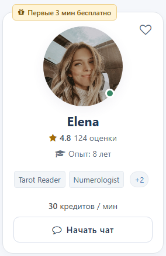
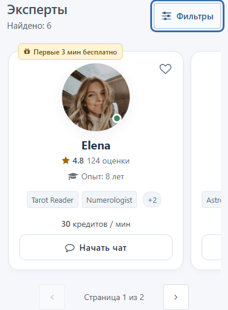
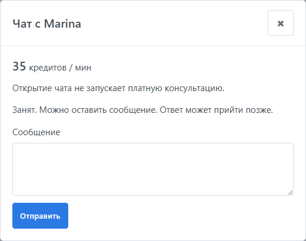
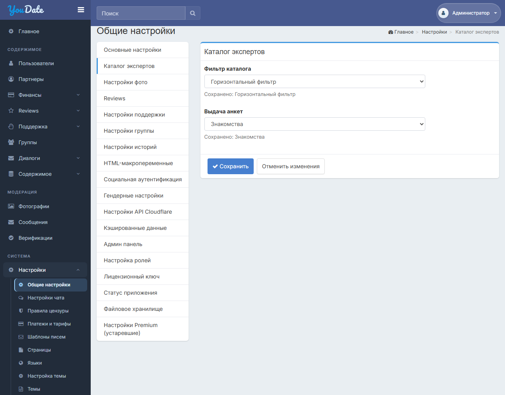
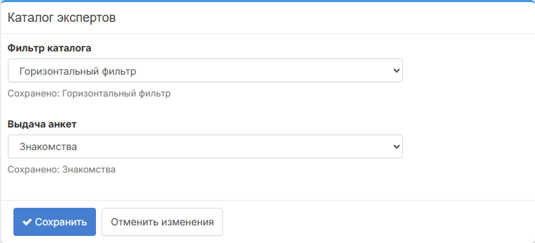
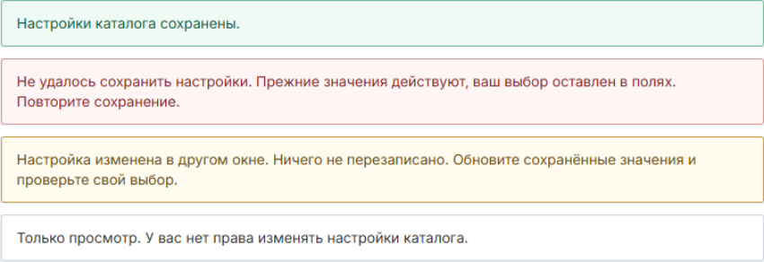

# Задача 2. Выдача анкет и бесплатный чат

Редакция 02.11.2026. Задание Игорю на разработку. Иллюстрации — проектируемый результат на искусственных данных, не внедрение на рабочем сайте.

## Что нужно сделать

Посетитель сравнивает экспертов, открывает профиль, добавляет эксперта в избранное или начинает бесплатную переписку. Внедрить шаблон выдачи «Эзотерика» с новыми карточками экспертов, сохранив работающий шаблон «Знакомства». Администратор выбирает поле «Выдача анкет» отдельно от фильтра. У фильтра два варианта: «Горизонтальный фильтр» — текущая форма; «Вертикальный фильтр» — новая боковая панель.

В задачу входят сетка и мобильная лента, данные и действия карточки, состояния выдачи, все существующие входы в бесплатный чат и настройка «Выдача анкет». Форма и алгоритм поиска — отдельная задача фильтра. «Эзотерика» работает как с горизонтальным, так и с вертикальным фильтром. Шапку, логотип, общее меню, страницы направлений, географии, подбора и профиля заново не верстать.

Для выпуска комплекта нужны две общие части независимо от оформления: задача фильтра поставляет серверный отбор доступных экспертов, подсчёт и страницы; эта задача — единый вход в бесплатный чат для прежних и новых кнопок. Их можно установить заранее, оставив прежнюю форму и карточки. Переключатели меняют представление, а не права, состав экспертов или смысл чата. Приёмка одной задачи не заменяет проверки другой.

## Кто видит экспертов

**Гость** не вошёл в аккаунт, **клиент** вошёл. В каталоге гость видит только опубликованных, допущенных и доступных ему экспертов «В сети» (online). Клиент видит доступных экспертов трёх статусов: «В сети», «Занят» (busy), «Не в сети» (offline). «В сети» не гарантирует немедленного ответа или консультации.

Обычные пользователи, служебные записи, скрытые, заблокированные и недопущенные профили исключаются. Неизвестный статус также исключается для обеих ролей до подтверждения одного из трёх; его не подменять и не удалять профиль/историю. Правила выполняются до подсчёта и страниц, при любом оформлении, прямой ссылке, сбросе, обновлении и возврате браузером.

Ограничение каталога не запрещает читать прямой опубликованный профиль по действующим правам. Но действие чата требует входа и повторной проверки доступа.

## Состав и действия карточки

Перенести композицию рисунка 1. В новой карточке нет возраста, города, страны и биографии; сами поля не удаляются из анкеты и других страниц.

| Элемент | Содержание и действие |
| --- | --- |
| Фото и имя | Реальные публичные данные этого эксперта. Оба открывают его профиль. Если фото нет или оно не загрузилось — нейтральная заглушка, не чужой портрет |
| Сердце | Справа сверху, существующее избранное, не лайк. Отдельная кнопка с выбранным состоянием и доступным именем |
| Статус на портрете | «В сети»: зелёный заполненный; «Занят»: янтарный с минусом; «Не в сети»: полый серый. Название доступно при наведении, фокусе и нажатии, не только цветом |
| Рейтинг | Существующий компонент, оценка и число оценок. Не называть их числом текстовых отзывов. Нажатие ведёт к штатному разделу отзывов |
| Оценок нет / рейтинг выключен | При разрешённом показе без оценок — «Пока нет оценок». При выключенном показе рейтинга нет, без ложного нуля |
| Опыт | Реальный публичный стаж; пустое значение не заменять выдуманным |
| Направления | До двух меток, затем видимое «+N» с числом остальных. Раскрывается на месте, без открытия профиля или чата |
| Цена | Реальная положительная цена и единица над кнопкой. Если цена неизвестна — «Условия в чате», не «Бесплатно» |
| Бесплатное начало | Только если действительно применимо к посетителю. Гостю не обещать персональные минуты с неизвестным правом |
| «Начать чат» / Start chat | Бесплатная переписка с этим экспертом, не платный старт |

Другие существующие публичные направления не исчезают из карточки из-за отсутствия в новом фильтре. Внутренние идентификаторы, назначение и сведения оператора клиенту не раскрываются. Значения цены, стажа, рейтинга и минут из демо не являются рабочими настройками.

Фото, имя, сердце, рейтинг, раскрытие и чат — отдельные действия. Не делать всю карточку ссылкой с вложенными кнопками. Ошибка избранного не выглядит успешным добавлением; повтор не создаёт дубль. Отзывы и раскрытие не создают консультацию. Выдуманные текстовые отзывы не показывать.

## Выдача на компьютере и телефоне

Заголовок, «Найдено», условия, карточки и страницы относятся к одному поиску. От 576 CSS px две колонки, от 992 три, от 1200 четыре.

До 575 px — горизонтальная лента карточек текущей страницы с нативным свайпом. При двух и более карточках ширина каждой до 300 CSS px; на узком экране оставить 36 px для продолжения, промежуток 12 px. Единственная карточка — исключение: полная ширина ленты, даже больше 300 px, без места для несуществующего продолжения. Без автопрокрутки, зацикливания и дублей.

Ниже отдельная пагинация «Страница N из M», не счётчик слайдов; при одной странице её нет. На самой области ленты стрелки и Home/End перемещают карточки, но не перехватывают клавиши внутри кнопок. Tab достигает всех действий.

Футеры соседних карточек выровнены. Длинные имена и раскрытые направления увеличивают высоту, не закрывая цену и кнопку. До раскрытия длинные метки можно сократить многоточием; после него названия видны полностью. «+N» меняется на «−» с именем «Свернуть»; повтор и Escape закрывают, фокус остаётся на кнопке. Без дополнительных направлений длинные первые две метки переносятся сразу. Подсказка статуса закрывается Escape/нажатием вне, фокус возвращается к вызвавшему элементу.

Портрет 136×136 CSS px, на телефоне 116×116; имя на телефоне 20/25 px. Отступы карточки на телефоне: сверху 20 px, по бокам 18 px, снизу 16 px. Сохранить принятые радиусы карточки 18 px и кнопки 10 px. Белая карточка, контурная кнопка в покое; hover только с настоящим указателем, без изменения геометрии. На touch первое нажатие выполняет действие. Бейдж сверху не закрывает лицо, сердце и соседей. Шрифт не уменьшается пропорционально экрану.

Проверить ширины 320, 360, 375, 390, 480, 575, 576, 768, 992, 1280, 1440 CSS px; горизонтальные 667×375 и 844×390; русский/английский, текст 200%, уменьшенное движение и клавиатуру. Сохранить темы гостя и клиента, доступные имена и видимый фокус. Новый CSS ограничен контейнером выдачи; оболочку не менять.

## Загрузка, ошибка и возврат

Различать загрузку, пустоту и ошибку. Новый поиск сразу применяет условия, адрес и страницу, результат обозначается загружаемым. Старый ответ не заменяет новый. Ошибка сохраняет запрос/выбор, не выдаёт прежние карточки за новый успех и не называется результатом «0». «Повторить» выполняет тот же запрос без лишнего шага истории. Пустота предлагает изменить/сбросить условия, не подставляя недоступных экспертов.

Из профиля/чата и через «Назад»/«Вперёд» восстановить параметры, сортировку, язык и страницу; доступность пересчитать для текущей роли. Номер выше последнего привести к последней странице, заменив адрес без нового шага истории. Для пустоты номер 1, пагинации нет. Новый поиск и удаление условия ведут на первую страницу.

Открытие и отмена фильтра сохраняют горизонтальное положение ленты; поиск и смена страницы возвращают начало. Завершившийся запрос не перехватывает фокус у посетителя, уже перешедшего к другому действию. Смена оформления карточек не меняет состав, порядок, страницу, выбранного эксперта или смысл условий.

## Что происходит после «Начать чат»

Чат — постоянная бесплатная переписка пары **«этот клиент + этот эксперт»**. Определяется выбранный экспертный профиль, не случайный оператор и не первый профиль списка. Повторный клик, возврат после входа и новое открытие продолжают тот же диалог, второй не создаётся. Открытие не отправляет сообщение от имени клиента.

| Ситуация | Ожидаемое поведение |
| --- | --- |
| Гость нажал чат у эксперта в сети | Штатный вход/регистрация с сохранёнными экспертом, языком, поиском и исходной страницей. После успеха повторная проверка и открытие бесплатного диалога |
| Гость ищет занятого/отсутствующего в каталоге | Карточки нет, в том числе через прямые параметры и другую страницу |
| Гость нажал чат в разрешённом прямом профиле занятого/отсутствующего | Сначала вход, затем бесплатный диалог, если профиль остаётся доступен |
| Клиент, эксперт в сети | Бесплатный диалог, без автоматической платной консультации |
| Клиент, эксперт занят | Бесплатный диалог, можно оставить сообщение, немедленный ответ не обещан; не бронирование и не платная очередь |
| Клиент, эксперт не в сети | Бесплатный диалог, сообщение для ответа позже, без обещания мгновенного ответа |
| Во время входа эксперт стал занят/вышел из сети | Диалог остаётся доступен клиенту при отсутствии иных ограничений; показать актуальный статус, не навязывать другого эксперта |
| Профиль стал скрытым, заблокированным, недопущенным | «Эксперт недоступен» и возврат; без нового диалога, сообщения, заявки и оплаты |

**Отмена входа** возвращает к исходному месту с языком и условиями, без сообщения/оплаты. Отменённое намерение не запускается из старого адреса. **Ошибка открытия** сохраняет эксперта и контекст, предлагает повтор/возврат. Повтор находит тот же диалог. Просроченная авторизация ведёт к входу с тем же намерением. Адрес возврата — только штатный внутренний маршрут, не произвольный внешний сайт.

Историю существующей переписки с недоступным профилем не удалять. Её чтение/отправка регулируются действующими правами чата, это ТЗ не вводит обход блокировки.

## Все существующие входы в бесплатную переписку

Подключить единую логику не только в новых карточках. Таблица перечисляет существующие действия, а не поручает заново верстать страницы. Если на конкретной странице кнопки чата нет, добавлять её по этой таблице не нужно.

| Откуда нажимают | Гость | Клиент | Что сохранить |
| --- | --- | --- | --- |
| Каталог, прежние и новые карточки | В выдаче только в сети; чат через вход | Три статуса, тот же бесплатный диалог | Фильтр, сортировку, страницу и язык |
| Карточки главной, направления, географии, подбора | Гостевая экспертная выдача только в сети; чат через вход | Выбранный эксперт любого из трёх статусов | Компоновку, SEO и содержание страниц |
| Прямой профиль | Штатная видимость; чат через вход | Тот же бесплатный диалог | Формы, отзывы и права профиля |
| Избранное | Штатный вход, если раздел требует его | Тот же эксперт/диалог любого статуса | Правила и данные избранного |
| Существующая переписка | Штатный вход | Существующая история, статус не создаёт новый диалог | Историю, доставку, действующую платную сессию |

Возврат восстанавливает исходную выдачу и контекст. Разные точки входа не создают разные диалоги с одним экспертным профилем.

## Бесплатный диалог и платная консультация

Просмотр карточки, «Начать чат», вход и бесплатное сообщение **не запускают таймер, списание, начисление или платную сессию**. Нулевой баланс не запрещает открыть бесплатную переписку.

Платный путь отдельный: запрос клиента или предложение эксперта → показ реальных условий → явное согласие клиента → повторные проверки → отдельное действие **Start — запуск платной консультации экспертом/оператором**. Само согласие часы не включает. Существующий модуль отвечает за допустимость, цену, баланс, назначение и запуск. Карточки не реализуют этот модуль, не меняют цены и действующую платную сессию.

Занятость/отсутствие не заменяются «Забронировать» и не создают платную очередь. Асинхронной платной консультации в этом объёме нет. «Уведомить о доступности» возможно лишь как существующая включённая функция после явной подписки: чат сам не подписывает и не уведомляет. Новую функцию уведомлений не добавлять.

## Где настраивается выдача анкет

Открыть в действующей админке **«Настройки → Общие настройки»**. В её внутреннее вертикальное меню добавить **«Каталог экспертов» после «Основные настройки», перед «Настройки фото»**. Сейчас такого подраздела нет; это конкретное место нового добавления. Главное левое меню, логотип и шапку не менять.

Одна форма «Каталог экспертов» с обычными полями и кнопками текущей админки:

| Поле | Варианты |
| --- | --- |
| Фильтр каталога | «Горизонтальный фильтр» / «Вертикальный фильтр». Форма поиска; подключение относится к задаче фильтра |
| Выдача анкет | «Знакомства» / «Эзотерика». Представление выдачи и карточек; подключение относится к этому ТЗ |

Под каждым полем «Сохранено: …». Выбор — черновик до **«Сохранить»**. **«Отменить изменения»** возвращает последние сохранённые значения без записи. Если значение не задано, для фильтра используется «Горизонтальный фильтр», для выдачи анкет — «Знакомства»; каждое поле проверяется отдельно. Установка файлов сама не включает новые варианты.

| Фильтр каталога | Выдача анкет | Результат |
| --- | --- | --- |
| Горизонтальный фильтр | Знакомства | Существующие поиск и шаблон выдачи с общими правилами роли и бесплатного чата |
| Вертикальный фильтр | Знакомства | Новая боковая панель, существующий шаблон выдачи |
| Горизонтальный фильтр | Эзотерика | Существующая форма, новый шаблон с карточками экспертов |
| Вертикальный фильтр | Эзотерика | Новая боковая панель, новый шаблон с карточками экспертов |

Названия «Знакомства» и «Эзотерика» обозначают только шаблоны представления. В каталоге экспертов оба соблюдают одни правила доступности и бесплатного чата; «Знакомства» не возвращает в него обычных пользователей. Сохранение только поля «Выдача анкет» не меняет фильтр. Общая кнопка пишет только изменённые поля; два изменения применяются вместе либо отклоняются целиком, без ложного частичного успеха. Подтверждённое сервером сохранение действует в следующем запросе каталога без повторного входа; открытый каталог сам не перерисовывается. Обновление админки читает сохранённые значения, не старый черновик.

| Событие | Ожидаемое поведение |
| --- | --- |
| Успех | «Настройки каталога сохранены», подписи сохранённых значений обновлены |
| Ошибка | «Не удалось сохранить настройки. Прежние значения действуют, ваш выбор оставлен в полях. Повторите сохранение». Действуют прежние настройки, черновик сохранён |
| Два окна меняют разные поля | Каждое пишет только своё изменение, соседнее не затирается |
| Два окна меняют одно поле от прежнего состояния | Второе сообщает конфликт без перезаписи; видно актуальное значение и свой черновик. «Обновить сохранённые значения» перечитывает основу, оставляя черновик; затем сотрудник явно проверяет и сохраняет |
| Нет права изменения | Только разрешённый просмотр, недоступные поля/сохранение и причина. Сервер запрещает прямую запись |

Во время запроса исключить повтор записи; при потере ответа сначала перечитать результат. В действующем журнале — сотрудник, время, поле, старое/новое значение; новые роли не вводить. Возврат к шаблону «Знакомства» сохраняет «Эзотерику», профили, фильтры, предпочтения, избранное и переписки. Работающие текущие шаблоны сохраняются в приложении, исторический HTML их не заменяет. Поля и сообщения локализовать штатной системой.

## Приёмка задачи 2

Все строки — проверки после внедрения, сейчас «Не проверено». Макет не доказывает реальные права, доставку, сохранение переписки, деньги или платный запуск.

| № | Условия и действие | Ожидаемый результат |
| --- | --- | --- |
| 1 | Сравнить карточку с реальным профилем | Реальные публичные данные, без возраста/географии/биографии; другие страницы не изменены |
| 2 | Нажать по очереди фото, имя, сердце, «+N», рейтинг, чат | Отдельные действия с правильным экспертом, без конфликтующих вложений и оплаты |
| 3 | Нет/есть рейтинг и цена, рейтинг выключен, бесплатное начало неприменимо | Правдивые условия без ложных нулей/минут, оценки не названы текстовыми отзывами |
| 4 | Нет/ошибка фото, длинные поля, текст 200%, русский/английский | Нейтральная заглушка, переносы без перекрытий и выдуманных данных |
| 5 | Выбрать эксперта, войти/отменить вход, вернуться браузером | Эксперт и контекст сохранены, отменённое не повторяется, оплаты нет |
| 6 | Все статусы, неизвестный статус, закрытый профиль; гость и клиент | Гостю только «В сети», клиенту три известных статуса; недоступные/неизвестные исключены до подсчёта |
| 7 | Загрузка, пустота, ошибка, страницы, возврат, смена карточек | Выдача согласована с запросом, ошибка не ложный ноль, оформление не меняет набор/порядок |
| 8 | Телефон/компьютер, свайп, стрелки/Home/End, Tab, «+N», Escape; одна/несколько карточек | Сетка и лента как описано, без дублей, доступные действия, единственная карточка полной ширины |
| 9 | Дважды открыть чат каждого статуса, в том числе с нулевым балансом | Один бесплатный постоянный диалог без авто-сообщения, таймера, списания и начисления |
| 10 | Во время входа эксперт стал занят/вышел из сети либо профиль закрыт | Первые два — диалог с актуальным статусом; закрытый — безопасный отказ и возврат |
| 11 | Ошибка сети/просроченная авторизация при открытии, повтор | Тот же эксперт/диалог и контекст, без дублей и внешнего небезопасного возврата |
| 12 | Каждая строка таблицы существующих входов в переписку | Один эксперт/диалог, правильный возврат, без редизайна и создания отсутствующих кнопок |
| 13 | Открыть чат, отправить бесплатное сообщение, согласиться на платное предложение без Start | Баланс, начисления и таймер неизменны; платный старт — отдельное действие существующего модуля |
| 14 | Четыре сочетания настроек, обновление, переключение «Эзотерика» → «Знакомства», ошибка, два окна | Независимость, сохранённый черновик при ошибке, конфликт без затирания, оба шаблона и данные сохранены |

Игорь передаёт реализованные страницы/переходы, изменённые файлы, заполненную приёмку с доказательствами и остатком; затем QA/PM проверяет согласованную среду. Пакет сам не разрешает production deploy, рабочие платежи или изменение действующей консультации.

## Техническое приложение

Коды нужны для происхождения и передачи агенту; весь продуктовый смысл изложен выше.

| Код | № проверки выше |
| --- | --- |
| F13 | 1 |
| F15 | 2 |
| F16 | 3 |
| F17 | 4 |
| F18 | 5 |
| C01 | 6 |
| C02 | 7 |
| C03 | 8 |
| C04 | 9 |
| C05 | 10 |
| C06 | 11 |
| C07 | 12 |
| C08 | 13 |
| S02 | 14 |

`integration/cards/` — самостоятельные partial, CSS/JS, AssetBundle без фильтра. Сетка/лента ограничена `.cl-catalog-results`, не требует `.cl-catalog-filter`. Рейтинг и избранное брать из существующих компонентов. `cards/views/_results.php` — пример view, не серверный поиск. HTML компонентов только доверенный результат серверного view, URL проверяет приложение. `integration/shared/` — схема представлений/входа, не новый платный модуль. Данные, авторизацию и сообщения демо не переносить вместо реальных. `CODEX.html`/`CODEX.md` — производное ТЗ для агента.

Целевой новый подраздел `admin/settings/catalog`, категория `catalog`, пункт в текущем `settings/_layout.php`. Старая локальная копия Yii подтверждает семейство `SettingsController`/`SettingsAction`/`SettingsForm`, не сегодняшний backend. Сверить актуальный репозиторий. Предлагаемые ключи: `catalog.filter_version`: `1` — «Горизонтальный фильтр», `2` — «Вертикальный фильтр»; `catalog.cards_version` для поля «Выдача анкет»: `1` — «Знакомства», `2` — «Эзотерика». При отсутствии настройки значение `1`. При существующих эквивалентных ключах адаптировать без второго источника. Штатные защита формы, права и журнал; allowlist, запись изменённых полей, исходная ревизия каждого, атомарность. Публичный URL настройку не меняет. Готовая форма `integration/admin/catalog-settings.html` и её CSS `catalog-settings.css` ограничены `.cl-catalog-admin`; полный HTML-макет — `admin.html`, со всеми локальными стилями и ресурсами. Служебных тестовых контролов в его интерфейсе нет. Замороженный `admin-shell/` не переносить как глобальные стили.

Предметное основание: «Профиль эксперта» G3.3, разделы 9–10; «Подбор и старт» G3.4, разделы 9–12; решения владельца и карта продукта Nebula. Выдержки в `sources/source-excerpts.md`, но для понимания поведения читать их не требуется. Статическая подпись Book session не доказывает бронирования, эта задача его не добавляет. `legacy-reference/` — история, не актуальное ТЗ и не рабочие серверные шаблоны.
