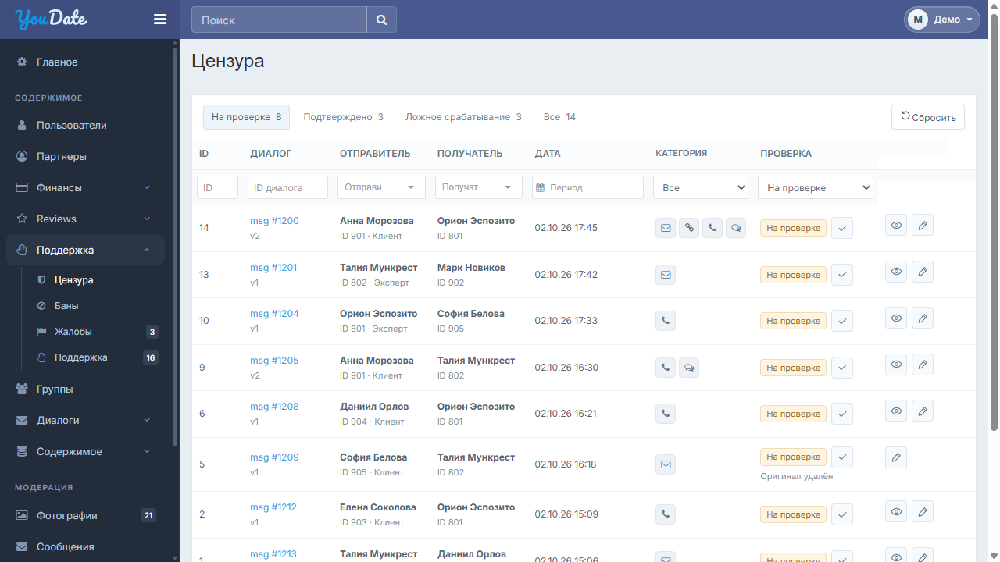
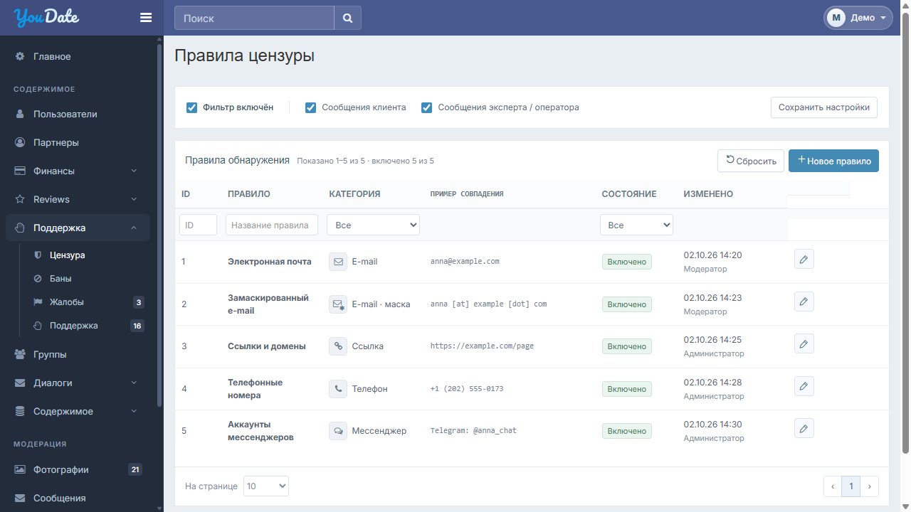

# Цензура — правки для Игоря · r1

Комплект только по журналу и правилам цензуры, по согласованным макетам25.10.2026. Рабочие контроллеры, права, паттерны обнаружения и общая оболочка сохраняются.

- [Открыть удобную страницу комплекта](index.html)
- [Короткая инструкция Игорю](IGOR-CODEX.md)
- [CSS и границы внедрения](CSS-INTEGRATION.md)
- [Общий период](SHARED-PERIOD.md)
- [Журнал — интерактивный макет](preview/contact-incidents.html)
- [Правила — интерактивный макет](preview/contact-rules.html)
- [Чек-лист приёмки XLSX](ACCEPTANCE.xlsx)
- [Скачать полный комплект ZIP](censorship-igor-20261025-r1.zip)

В integration — только шесть presentation-файлов. В preview — демонстрация с отдельными неизменёнными CSS/библиотеками и фиксированными данными. Preview-оболочку/vendor/controller-adapters на сайт не переносить. Состояние local UI проверяется в QA.json; серверная/ролевая приёмка и физические устройства отдельно.

Для локального просмотра распаковать ZIP и выполнить из его папки: `python -m http.server 8765 --bind 127.0.0.1`. Затем открыть http://127.0.0.1:8765/index.html. Интернет для макетов не требуется. На GitHub исходный HTML показывается как код; для интерактивного просмотра использовать опубликованную страницу комплекта либо локальный HTTP.

