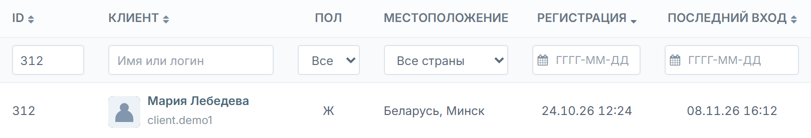
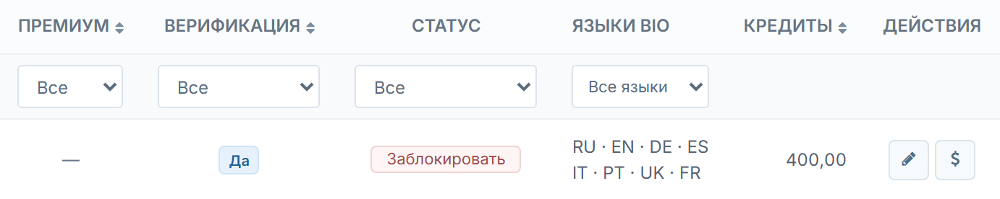
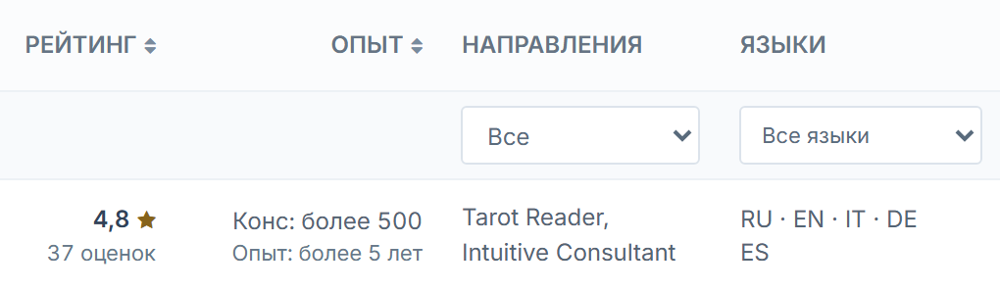
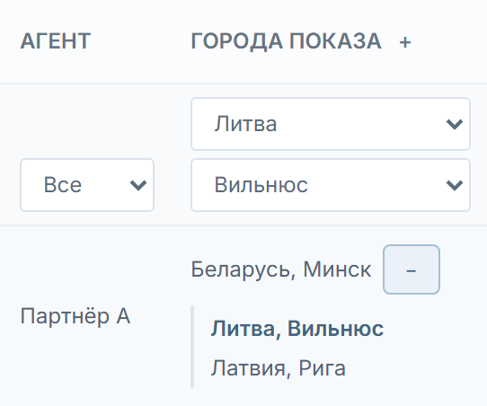

# Разделить пользователей на клиентов и экспертов

Редакция 4 · 10 ноября 2026

В меню админки нужны два отдельных пункта. «Клиенты» открывает список аккаунтов, «Эксперты» — список экспертных анкет. Состав столбцов, порядок и вид элементов берём из приложенных макетов. Действующая админка и поля профиля служат источниками данных для реализации.

Сейчас оба типа записей находятся в общем списке «Пользователи». Закрепление и города эксперта проверяются отдельно в разделе «Партнёры → Анкеты».

[Исходная страница · 09.11.2026](evidence/before-users.png) · [Все материалы](index.html)

## 1. Клиенты

/ru/admin/user/index

Оставить действующий адрес списка пользователей и переименовать пункт меню в «Клиенты». В этот список выводить аккаунты клиентов. Команда «Создать» ведёт к действующей форме создания обычного аккаунта.

[Макет «Клиенты»](preview/clients.html) · [Строка Марии Лебедевой](preview/clients.html?filter_id=312) · [Строка Алексея Волкова с активным премиумом и остатком 0,00](preview/clients.html?filter_id=311) · [Строка Анны Соколовой с командой «Разблокировать»](preview/clients.html?filter_id=310)

Мария Лебедева, ID 312. Данные аккаунта, местоположение и даты.

Та же строка. Значок верификации, блокировка, восемь языков bio и остаток кредитов.

### Поля и источники

| Поле | Откуда брать | Как показывать и использовать |
| --- | --- | --- |
| Выбор | Строки текущей страницы таблицы. | Один флажок на строку. Общий флажок выбирает только текущую страницу. |
| ID | «Пользователи → карточка пользователя», ID аккаунта. | Точный поиск и сортировка по числу. Шесть цифр полностью видны в ячейке и поле ввода. |
| Клиент | Имя и фото из профиля, логин из аккаунта. | Имя открывает карточку, логин расположен под именем. При отсутствии фото — штатная заглушка. Поиск по части имени или логина. |
| Пол | Карточка пользователя → «Информация профиля → Пол». | М, Ж или прочерк. Такие же обозначения в фильтре после «Все». Вариант с прочерком нужен при наличии записей без значения. |
| Местоположение | Карточка пользователя → «Расположение», пара страны и города из справочника. | Показывать «Страна, город», при наличии только страны — страну. Если сохранённая пара не согласуется со справочником, показать исходное значение и исключить неверную пару из поиска по городу. |
| Регистрация | Общий список «Пользователи» и дата регистрации в карточке аккаунта. | Дата и время. Начальная сортировка от новых к старым. Фильтр по одному календарному дню. |
| Последний вход | Столбец «Последний вход» действующего списка пользователей. | Дата и время. Если входа не было — прочерк. Фильтр по одному дню и сортировка по дате. |
| Премиум | Столбец «Премиум» действующего списка пользователей, актуальный признак аккаунта. | Метка «Активен» или прочерк. Фильтр «Да / Нет» и сортировка по признаку. |
| Верификация | Наличие значка в карточке пользователя. Действующая команда «Добавить значок верификации». | «Да» при наличии значка, иначе «Подтвердить» у сотрудника с правом. Фильтр «Да / Нет» и сортировка. |
| Статус | «Статус блокировки» в карточке аккаунта и штатные команды в списке пользователей. | «Заблокировать» или «Разблокировать». Фильтр «Без блокировки / Заблокирован». Активация аккаунта проверяется отдельно в карточке. |
| Языки bio | «Редактировать профиль → Описание» и сохранённые переводы этого же поля. | Вывести коды только для непустого текста. Код основного текста брать, если его язык известен из данных. До четырёх кодов на строку. Выбранный в фильтре код выделить. |
| Кредиты | Карточка пользователя → «Баланс», строка «Текущий баланс». | Текущий остаток с двумя знаками, например видимые в макете 400,00 или 0,00. Прочерк, если остаток недоступен. Данные и сортировка доступны по финансовому праву. |
| Действия | Штатные формы редактирования и корректировки баланса выбранного аккаунта. | Кнопки редактирования и корректировки кредитов по правам. Карточка открывается по имени. Верификация и блокировка выполняются в своих колонках. |

[Действующий список «Пользователи»](https://confideline.com/ru/admin/user/index)

## 2. Эксперты

/ru/admin/expert/index

Добавить отдельный пункт «Эксперты». Новая анкета, созданная кнопкой «Создать», сразу появляется в этом списке. Назначить агента можно после создания.

[Макет «Эксперты»](preview/experts.html) · [Строка Марины Север](preview/experts.html?filter_id=512) · [Города Марины Север при фильтре по Вильнюсу](preview/experts.html?filter_id=512&filter_country=lt&filter_cities=vilnius) · [Строка Софии Луны с кнопкой «Назначить»](preview/experts.html?filter_id=511)

Марина Север, ID 512. Рейтинг, опыт, два направления и пять языков.

Та же строка. Основной город Минск. После выбора Вильнюса и раскрытия списка совпавший город выделен.

### Поля и источники

| Поле | Откуда брать | Как показывать и использовать |
| --- | --- | --- |
| Выбор | Строки текущей страницы таблицы. | Такой же выбор строк и текущей страницы, как у клиентов. |
| ID | ID аккаунта экспертной анкеты в карточке пользователя. В разделе «Партнёры → Анкеты» это ID пользователя по ссылке из строки закрепления. | Сортировка и точный поиск по ID анкеты. ID связи с партнёром используется только для операций над связью. |
| Эксперт | Имя или псевдоним и фото из экспертной анкеты, логин связанного аккаунта. | Имя открывает анкету, логин — второй строкой. Поиск по части имени или логина. |
| Пол | Пол из карточки профиля экспертной анкеты. | М, Ж или прочерк. Фильтр такой же, как у клиентов. |
| Рейтинг | Итоговая оценка и число голосов из того же источника, что и рейтинг на публичной странице эксперта. Сверять с действующим разделом настроек рейтинга. | Число и звезда, количество оценок на второй строке. При отсутствии оценок — прочерк. Сортировка по числу, прочерки в конце. Текстовые отзывы считаются отдельно. |
| Опыт | Поля профиля №19 «Количество консультаций» и №20 «Мой опыт». Брать выбранные варианты этих полей. | Формат на снимке «Конс: более 500» и «Опыт: более 5 лет». При пустом №19 — прочерк, заполненный стаж остаётся виден. Пустой №20 не выводится. Сортировка по числовому порогу №19, пустые в конце. |
| Направления | Поле №17 Areas. Использовать сохранённые ключи и подписи его справочника. | Показывать выбранные направления и фильтровать по любому из них. Темы обращений из №18 Specialization остаются в карточке анкеты. |
| Языки | Поле №21 My Languages. Использовать сохранённые ключи 13 вариантов. | Коды в том же формате, что у клиентов. Выбранный в фильтре язык выделяется. Фильтры по языкам и направлениям применяются вместе. |
| Агент | «Партнёры → карточка партнёра → Анкеты», действующая связь с выбранной экспертной анкетой. | Один агент на анкету. При отсутствии связи кнопка «Назначить» открывает выбор одного партнёра с ролью агента. Фильтр по агенту и «Не назначен». |
| Города показа | Штатная настройка «Города эксперта» в разделе «Партнёры → Анкеты». Основной и дополнительные города берутся из настроек конкретной анкеты. | Показать основную пару «Страна, город» и +N. Кнопка раскрывает дополнительные пары внутри строки. Плюс в заголовке раскрывает их у всех. Фильтр учитывает и основную, и дополнительные пары. |
| Верификация | Значок на связанном аккаунте экспертной анкеты и штатная команда его добавления. | «Да» или «Подтвердить». Фильтр и сортировка по признаку, как у клиентов. |
| Статус | Статус блокировки связанного аккаунта экспертной анкеты. | «Заблокировать» или «Разблокировать». Фильтр такой же, как у клиентов. Публикация анкеты в каталоге проверяется отдельно. |
| Действия | Штатный редактор экспертного профиля, реестр отзывов и форма корректировки кредитов связанного аккаунта. | Редактирование, отзывы и корректировка по правам. Отзывы открываются с точным фильтром по ID эксперта. Форма кредитов открывается для аккаунта самой анкеты. |

[Партнёры и закрепления](https://confideline.com/ru/admin/partner/index) · [Отзывы](https://confideline.com/ru/admin/review/index) · [Настройки рейтинга](https://confideline.com/ru/admin/review/settings) · [Направления, поле №17](https://confideline.com/ru/admin/profile-field/update?id=17) · [Темы обращений, поле №18](https://confideline.com/ru/admin/profile-field/update?id=18) · [Консультации, поле №19](https://confideline.com/ru/admin/profile-field/update?id=19) · [Стаж, поле №20](https://confideline.com/ru/admin/profile-field/update?id=20) · [Языки, поле №21](https://confideline.com/ru/admin/profile-field/update?id=21)

## 3. Общие правила и приёмка

### Состав списков

Аккаунт клиента и экспертная анкета принадлежат разным спискам. Рабочая учётная запись партнёра остаётся в «Партнёрах». Отсутствие агента, блокировка или скрытие в каталоге не меняют тип экспертной анкеты. До переключения сверить тип и итоговый список по ID каждой существующей записи. Если текущая схема хранит только закрепление, нужен отдельный признак экспертной анкеты, который сохраняется уже при создании. Неоднозначные существующие записи сверить до переноса.

### Страны и города

После выбора страны появляется фильтр города. Он содержит города этой страны, в названиях страна не повторяется. При смене страны неподходящий город сбрасывается. Для экспертов совпадение по дополнительному городу видно даже в свёрнутой строке. В раскрытой строке совпадение выделено. Общий плюс в заголовке работает и после перехода на другую страницу.

### Фильтры и список

Фильтры применяются вместе. Сортировка и фильтры работают по всей выборке до пагинации. При равных значениях использовать ID как второй ключ. Записи без рейтинга, количества консультаций, даты входа или остатка показывать в конце соответствующей сортировки. Размер страницы 10, 20, 50 или 100, по умолчанию 20. Фильтр, сортировка и размер страницы возвращают к первой странице. Сброс очищает фильтры и восстанавливает начальную сортировку. При пустой выдаче показать сообщение. Смена страницы или условий снимает выбор строк. Массовая команда в эту задачу не входит.

### Действия и права

Администратор и другие разрешённые роли видят только доступные списки и команды. Сотруднику без права изменения показывается состояние верификации и блокировки текстом. Операции требуют штатного подтверждения. После успеха строка обновляется. При отмене или ошибке остаются прежние данные. При неизвестном исходе сначала прочитать текущее состояние с сервера. Повторное подтверждение верификации из устаревшей строки не снимает уже установленный значок. Прямые переходы и действия проверяют права и адресата на сервере. При возврате из карточки сохраняются фильтры, сортировка, размер и страница.

### Вёрстка

Сохранить действующие шапку, меню и общий стиль админки. Столбцы заполняют рабочую ширину. При нехватке места таблица прокручивается внутри своей области. До 767 px строки превращаются в карточки, доступны кнопка фильтров, сортировка и выбор страницы. В списках нет вкладок. Для другой локали используется её обычный префикс адреса.

### Как проверить на тестовом сайте

| № | Что проверить | Действия | Ожидаемый результат |
| --- | --- | --- | --- |
| 1 | Клиенты | Открыть строку 312 по ссылке из ТЗ. Сверить данные аккаунта, 8 кодов bio и кредиты. Сравнить строки 311 и 310. | Два ряда языков. Ноль отличается от прочерка. Метка премиума и команда разблокировки отображаются в соответствующих строках. |
| 2 | Эксперты | Открыть строку 512. Сверить рейтинг и опыт с указанными в ТЗ полями. Выбрать Литву и Вильнюс и раскрыть города. | 4,8 и 37 оценок. Две строки опыта. Выбранный дополнительный Вильнюс виден и выделен. |
| 3 | Действия | Создать экспертную анкету без агента, назначить агента. Проверить отмену, ошибку, повторное открытие, верификацию и блокировку. | Анкета сразу в «Экспертах». Успех меняет строку. Отмена и ошибка сохраняют прежние данные. |
| 4 | Состав и права | Сверить распределение клиентов, экспертов и партнёров. Проверить права администратора и агента, включая прямой адрес чужой анкеты. Открыть отзывы и кредиты из строки. | Анкета в правильном списке. Действия только по праву. Отзывы и кредиты относятся к выбранной записи. |
| 5 | Списки и ширина | Сменить сортировку, фильтры, страницу, размер и вернуться из карточки. Проверить на широком экране и на 390 и 320 px. | Выбор и параметры списка ведут себя по ТЗ. На телефоне доступны фильтры, карточки и разрешённые действия. Внешняя оболочка сохраняется. |

Макеты показывают интерфейс на вымышленных записях. Сохранение на сервере и права ролей проверяются после внедрения.
