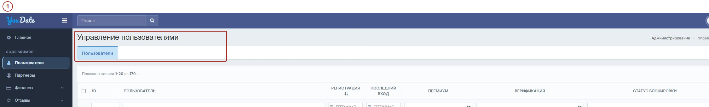
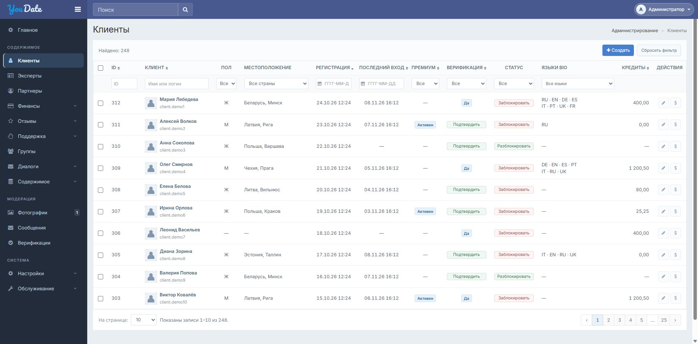
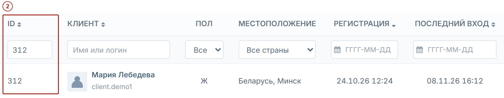
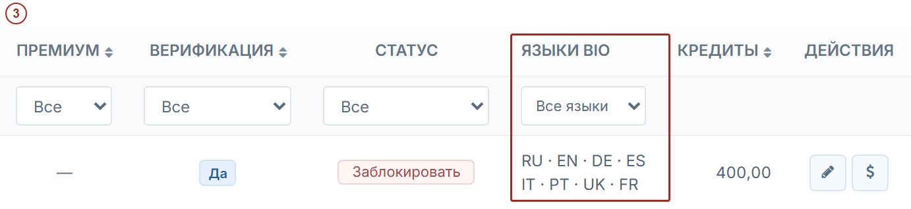
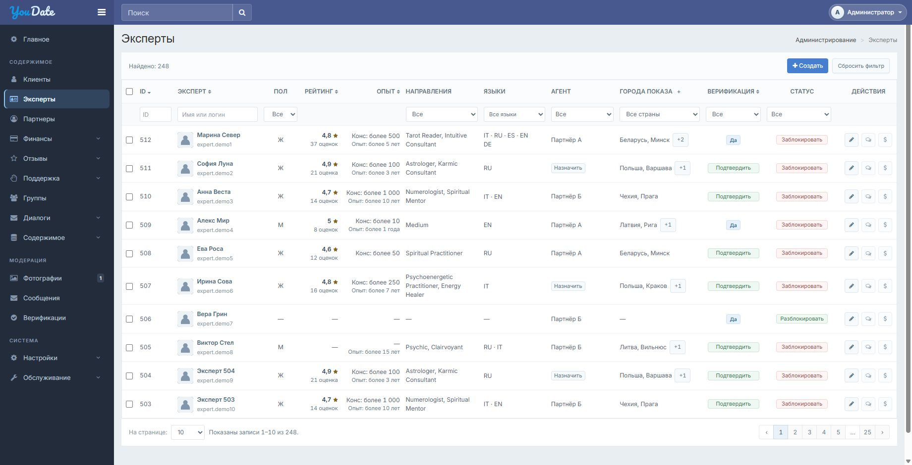
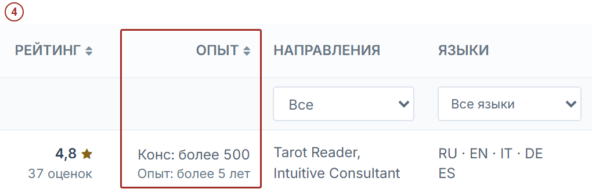
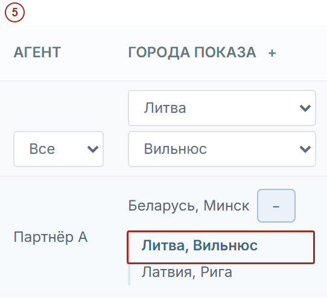
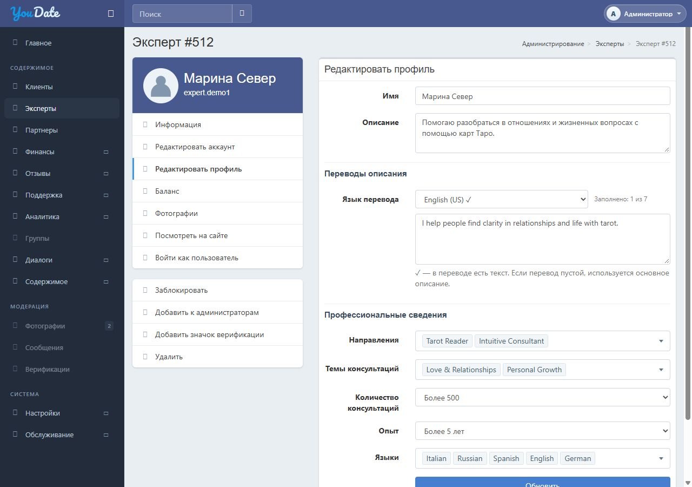
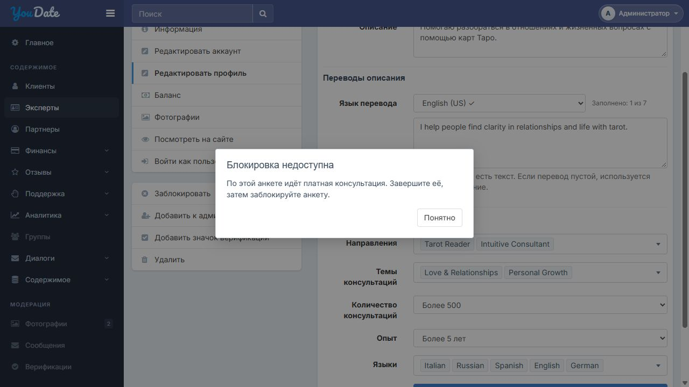

# Техническое задание на списки клиентов и экспертов

Редакция 9 от 10.11.2026 · Confideline DEV

Снимок редакции на дату публикации. Дальнейшие правки ведутся в [основном ТЗ в Google Docs](https://docs.google.com/document/d/16Ogc9FnUUOMAKoHERz4bEqezbzjqsn4R91KFPH2SU_w/edit).

Игорь, разделите общий список пользователей админки на две страницы. Клиентские аккаунты остаются на действующем адресе. Экспертные анкеты получают отдельный адрес и свой набор столбцов. Переходы к карточкам, редактированию аккаунта, отзывам и кредитам проверяйте на тестовом сайте по штатным маршрутам.

В действующей админке есть один список «Пользователи». Чтобы проверить агента и города эксперта, администратор открывает «Партнёры → Анкеты». На рисунке 1 выделен исходный список.

Рисунок 1. Действующая админка, 09.11.2026. Выделен общий список «Пользователи». [Исходный снимок](evidence/before-users.png)

## 1 Клиенты

/ru/admin/user/index

Оставить действующий адрес списка пользователей и переименовать пункт меню в «Клиенты». В этот список выводить аккаунты клиентов. Команда «Создать» открывает действующую форму создания пользователя /ru/admin/user/create.

[Макет «Клиенты»](preview/clients.html) · [Строка Марии Лебедевой](preview/clients.html?filter_id=312)

Целевой экран «Клиенты». Отдельный пункт меню, фильтры и действия по аккаунту. [Интерактивный макет](preview/clients.html) · [Мобильный вид](evidence/clients-390.png)

### Найти клиента

В макете «Клиенты» поиск по ID 312 показывает Марию Лебедеву. На тестовом сайте по имени клиента открывается действующая карточка «Пользователь \#ID» по адресу /ru/admin/user/info?id=\<ID аккаунта\>. После возврата сохраняются фильтр и место в списке. Рисунок 2.

Рисунок 2. Макет «Клиенты». Выделен точный поиск Марии Лебедевой по ID 312. [Исходный снимок](evidence/clients-profile.png)

### Проверить данные аккаунта

В строке Марии видны значок верификации, восемь языков описания и остаток 400,00. Рисунок 3. В строке Алексея Волкова видны активный премиум и нулевой остаток. У Анны Соколовой в «Статусе» доступна команда «Разблокировать».

Рисунок 3. Макет «Клиенты». У Марии Лебедевой восемь сохранённых языков bio, по четыре на строку. [Исходный снимок](evidence/clients-account.png)

[Строка Алексея Волкова с активным премиумом и остатком 0,00](preview/clients.html?filter_id=311) · [Строка Анны Соколовой с командой «Разблокировать»](preview/clients.html?filter_id=310)

### Поля и источники

| Поле | Откуда брать | Как показывать и использовать |
| --- | --- | --- |
| Выбор | Строки текущей страницы таблицы. | Один флажок на строку. Общий флажок выбирает только текущую страницу. |
| ID | «Пользователи → карточка пользователя», ID аккаунта. | Точный поиск и сортировка по числу. Шесть цифр полностью видны в ячейке и поле ввода. |
| Клиент | Имя и фото из профиля, логин из аккаунта. | Имя открывает карточку, логин расположен под именем. При отсутствии фото — штатная заглушка. Поиск по части имени или логина. |
| Пол | Карточка пользователя → «Информация профиля → Пол». | М, Ж или прочерк. Такие же обозначения в фильтре после «Все». Вариант с прочерком нужен при наличии записей без значения. |
| Местоположение | Карточка пользователя → «Расположение», пара страны и города из справочника. | Показывать «Страна, город», при наличии только страны — страну. Если сохранённая пара не согласуется со справочником, показать исходное значение и исключить неверную пару из поиска по городу. |
| Регистрация | Общий список «Пользователи» и дата регистрации в карточке аккаунта. | Дата и время. Начальная сортировка от новых к старым. Фильтр по одному календарному дню. |
| Последний вход | Столбец «Последний вход» действующего списка пользователей. | Дата и время. Если входа не было — прочерк. Фильтр по одному дню и сортировка по дате. |
| Премиум | Столбец «Премиум» действующего списка пользователей, актуальный признак аккаунта. | Метка «Активен» или прочерк. Фильтр «Да / Нет» и сортировка по признаку. |
| Верификация | Наличие значка в карточке пользователя. Действующая команда «Добавить значок верификации». | «Да» при наличии значка, иначе «Подтвердить» у сотрудника с правом. Фильтр «Да / Нет» и сортировка. |
| Статус | «Статус блокировки» в карточке аккаунта и штатные команды в списке пользователей. | «Заблокировать» или «Разблокировать». Фильтр «Без блокировки / Заблокирован». Столбец и его фильтр отражают только блокировку. Активация видна в карточке аккаунта. |
| Языки bio | «Редактировать профиль → Описание» и сохранённые переводы этого же поля. | Вывести коды только для непустого текста. Код основного текста брать, если его язык известен из данных. До четырёх кодов на строку. Выбранный в фильтре код выделить. |
| Кредиты | Карточка пользователя → «Баланс», строка «Текущий баланс». | Текущий остаток с двумя знаками, например видимые в макете 400,00 или 0,00. Прочерк, если остаток недоступен. Данные и сортировка доступны по финансовому праву. |
| Действия | Штатные формы редактирования и корректировки баланса выбранного аккаунта. | Кнопки редактирования и корректировки кредитов по правам. Карточка открывается по имени. Верификация и блокировка выполняются в своих колонках. |

[Действующий список «Пользователи»](https://confideline.com/ru/admin/user/index)

## 2 Эксперты

/ru/admin/expert/index

Добавить отдельный пункт «Эксперты». Кнопка «Создать» открывает форму создания аккаунта в режиме эксперта на основе действующей формы /ru/admin/user/create. При сохранении сервер записывает тип экспертной анкеты. После сохранения открыть первую страницу списка «Эксперты» со сброшенными фильтрами и сортировкой по убыванию ID. Новая анкета сразу видна в списке, в том числе без агента.

[Макет «Эксперты»](preview/experts.html) · [Строка Марины Север](preview/experts.html?filter_id=512)

Целевой экран «Эксперты». Отдельный пункт меню, рейтинг, опыт, агент и города показа. [Интерактивный макет](preview/experts.html) · [Мобильный вид](evidence/experts-390.png)

### Сверить анкету эксперта

В списке «Эксперты» администратор открывает строку Марины Север. В «Опыте» показаны «Конс: более 500» и «Опыт: более 5 лет». Рисунок 4. Рейтинг, направления и языки остаются отдельными столбцами.

Рисунок 4. Макет «Эксперты». У Марины Север показаны два значения поля «Опыт». [Исходный снимок](evidence/experts-experience.png)

### Найти эксперта по дополнительному городу

Администратор выбирает Литву и Вильнюс. Марина Север остаётся в выдаче, хотя её основной город Минск. Кнопка дополнительных городов раскрывает список в строке. Совпавший Вильнюс выделяется. Рисунок 5.

Рисунок 5. Макет «Эксперты». Вильнюс входит в дополнительные города Марины Север и выделен после фильтрации. [Исходный снимок](evidence/experts-cities.png)

[Города Марины Север при фильтре по Вильнюсу](preview/experts.html?filter_id=512&filter_country=lt&filter_cities=vilnius)

### Назначить агента

Сейчас администратор открывает «Анкеты» нужного партнёра и выбирает анкету эксперта. В новом списке он начинает со строки анкеты. У Софии Луны агента нет. По кнопке «Назначить» администратор выбирает партнёра и подтверждает действие. То же закрепление видно в строке эксперта и в «Анкетах» партнёра. Отмена оставляет строку как была. При ошибке форма остаётся открытой с выбранным партнёром и показывает причину.

[Штатный экран «Анкеты» партнёра](https://confideline.com/ru/admin/chief-under/index?userId=195) · [Строка Софии Луны с кнопкой «Назначить»](preview/experts.html?filter_id=511)

### Поля и источники

| Поле | Откуда брать | Как показывать и использовать |
| --- | --- | --- |
| Выбор | Строки текущей страницы таблицы. | Такой же выбор строк и текущей страницы, как у клиентов. |
| ID | ID аккаунта экспертной анкеты в карточке пользователя. В разделе «Партнёры → Анкеты» это ID пользователя по ссылке из строки закрепления. | Сортировка и точный поиск по ID анкеты. ID связи с партнёром используется только для операций над связью. |
| Эксперт | Имя или псевдоним и фото из экспертной анкеты, логин связанного аккаунта. | Логин показан второй строкой. На сайте имя открывает штатную карточку аккаунта выбранного эксперта. Поиск по части имени или логина. |
| Пол | Пол из карточки профиля экспертной анкеты. | М, Ж или прочерк. Фильтр такой же, как у клиентов. |
| Рейтинг | Итоговая оценка и число голосов из того же источника, что и рейтинг на публичной странице эксперта. Сверять с действующим разделом настроек рейтинга. | Число и звезда, количество оценок на второй строке. При отсутствии оценок — прочерк. Сортировка по числу, прочерки в конце. Текстовые отзывы считаются отдельно. |
| Опыт | Поля профиля №19 «Количество консультаций» и №20 «Мой опыт». Брать выбранные варианты этих полей. | Формат на снимке «Конс: более 500» и «Опыт: более 5 лет». При пустом №19 — прочерк, заполненный стаж остаётся виден. Пустой №20 не выводится. Сортировка по числовому порогу №19, пустые в конце. |
| Направления | Поле №17 Areas. Использовать сохранённые ключи и подписи его справочника. | Показывать выбранные направления и фильтровать по любому из них. Темы обращений из №18 Specialization остаются в карточке анкеты. |
| Языки | Поле №21 My Languages. Использовать сохранённые ключи 13 вариантов. | Коды в том же формате, что у клиентов. Выбранный в фильтре язык выделяется. Фильтры по языкам и направлениям применяются вместе. |
| Агент | Штатное закрепление анкеты в разделе «Партнёры → Анкеты». Имя берётся из записи закреплённого партнёра. | Один агент на анкету. Без закрепления кнопка «Назначить» открывает список партнёров, за которыми штатный механизм разрешает закрепить эту анкету. Фильтр по агенту и «Не назначен». |
| Города показа | Штатная настройка «Города эксперта» в разделе «Партнёры → Анкеты». Основной и дополнительные города берутся из настроек конкретной анкеты. | Показать основную пару «Страна, город» и +N. Кнопка раскрывает дополнительные пары внутри строки. Плюс в заголовке раскрывает их у всех. Фильтр учитывает и основную, и дополнительные пары. |
| Верификация | Значок на связанном аккаунте экспертной анкеты и штатная команда его добавления. | «Да» или «Подтвердить». Фильтр и сортировка по признаку, как у клиентов. |
| Статус | Статус блокировки связанного аккаунта экспертной анкеты. | «Заблокировать» или «Разблокировать». Фильтр такой же, как у клиентов. Столбец и его фильтр отражают только блокировку. Публикация в каталоге проверяется отдельно. |
| Действия | Штатный редактор экспертного профиля, реестр отзывов и форма корректировки кредитов связанного аккаунта. | Редактирование, отзывы и корректировка по правам. Отзывы открываются с точным фильтром по ID эксперта. Форма кредитов открывается для аккаунта самой анкеты. |

[Партнёры и закрепления](https://confideline.com/ru/admin/partner/index) · [Отзывы](https://confideline.com/ru/admin/review/index) · [Настройки рейтинга](https://confideline.com/ru/admin/review/settings) · [Направления, поле №17](https://confideline.com/ru/admin/profile-field/update?id=17) · [Темы обращений, поле №18](https://confideline.com/ru/admin/profile-field/update?id=18) · [Консультации, поле №19](https://confideline.com/ru/admin/profile-field/update?id=19) · [Стаж, поле №20](https://confideline.com/ru/admin/profile-field/update?id=20) · [Языки, поле №21](https://confideline.com/ru/admin/profile-field/update?id=21)

## 3 Общие правила

### Состав списков

Аккаунт клиента и экспертная анкета принадлежат разным спискам. Партнёр использует ранее зарегистрированный аккаунт пользователя, переведённый штатной командой «Добавить к администраторам». Рабочая карточка ведётся в разделе «Партнёры» и скрыта с клиентской части сайта. Аккаунт партнёра исключается из списков «Клиенты» и «Эксперты». Закреплённая за агентом экспертная анкета показывается отдельно в списке «Эксперты». Отсутствие агента, блокировка или скрытие в каталоге не меняют тип экспертной анкеты. До переключения сверить тип и итоговый список по ID каждой существующей записи. Если текущая схема хранит только закрепление, нужен отдельный признак экспертной анкеты, который сохраняется уже при создании. До переключения Игорь передаёт владельцу продукта список спорных ID с основаниями. Владелец продукта возвращает Игорю согласованную таблицу с ID, основанием и итоговым типом каждой спорной записи. Переключать списки можно после подтверждения всех спорных ID.

### Страны и города

После выбора страны появляется фильтр города. Он содержит города этой страны, в названиях страна не повторяется. При смене страны неподходящий город сбрасывается. Фильтр «Экспертов» учитывает основные и дополнительные города при любом состоянии строки. Совпавший дополнительный город виден и в свёрнутой строке. В раскрытой строке совпадение выделено. Общий плюс в заголовке работает и после перехода на другую страницу.

### Фильтры и список

Фильтры применяются вместе. Сортировка и фильтры работают по всей выборке до пагинации. При равных значениях использовать ID как второй ключ. Записи без рейтинга, количества консультаций, даты входа или остатка показывать в конце соответствующей сортировки. Размер страницы 10, 20, 50 или 100, по умолчанию 20. Фильтр, сортировка и размер страницы возвращают к первой странице. При открытии и после сброса клиенты сортируются от новых регистраций к старым, эксперты — по убыванию ID. Сброс также очищает фильтры. При пустой выдаче показать сообщение. Смена страницы или условий снимает выбор строк. Массовая команда в эту задачу не входит. Фильтры регистрации и последнего входа используют тот же часовой пояс, в котором эти даты показаны сотруднику в действующем списке «Пользователи».

### Действия и права

Агент с обычными правами видит только закреплённые за ним анкеты и может редактировать их в пределах выданных прав. Незакреплённые и чужие анкеты ему недоступны, в том числе по прямому адресу. Закреплять анкеты может сотрудник с отдельным правом управления закреплениями. Обычный агент сам себе анкеты не назначает. Сотруднику без права изменения показывается состояние верификации и блокировки текстом. Операции требуют штатного подтверждения. После успеха заново запросить выдачу с текущими фильтрами, сортировкой и размером страницы. Обновить строки, счётчик и пагинацию. При фильтре «Не назначен» закреплённая анкета исчезает из выдачи. Если текущей страницы больше нет, открыть последнюю доступную, при пустой выдаче — первую. При отмене или ошибке остаются прежние данные. При неизвестном исходе сначала прочитать текущее состояние с сервера. Повторное подтверждение верификации из устаревшей строки не снимает уже установленный значок. Прямые переходы и действия проверяют права и адресата на сервере. При возврате из карточки сохраняются фильтры, сортировка, размер и страница.

### Вёрстка

Сохранить действующие шапку, меню и общий стиль админки. Столбцы заполняют рабочую ширину. При нехватке места таблица прокручивается внутри своей области. До 767 px строки превращаются в карточки, доступны кнопка фильтров, сортировка и выбор страницы. В списках нет вкладок. Для другой локали используется её обычный префикс адреса.

Использовать действующие стили админки и сохранить общие CSS-файлы и порядок их подключения. Новые правила разместить в отдельном CSS-файле и подключить только на страницах этих списков и их собственных форм. Каждый селектор ограничить контейнером списка или формы. Файлы в preview/assets служат для просмотра макетов.

## 4 Приёмка на тестовом сайте

| № | Что проверить | Действия | Ожидаемый результат |
| --- | --- | --- | --- |
| 1 | Клиенты | В макете сверить строки 312, 311 и 310. На тестовом сайте повторить на записях с несколькими языками bio, премиумом и блокировкой. Проверить записи около полуночи по поясу отображения дат. | Коды переносятся на две строки. Ноль и прочерк различаются. Данные и команды соответствуют аккаунту. По имени клиента открывается действующая карточка «Пользователь \#ID» по адресу /ru/admin/user/info?id=\<ID аккаунта\>. В выборку входят записи с показанной датой выбранного дня. |
| 2 | Эксперты | В макете открыть строку 512 и выбрать Вильнюс. На тестовом сайте сверить поля опыта. Для тестовой анкеты выбрать дополнительный город и проверить выдачу до раскрытия и после раскрытия городов в строке. | Рейтинг и опыт совпадают с источниками анкеты. Совпавший дополнительный город виден и выделен. |
| 3 | Действия | С включённым фильтром создать анкету без агента. Найти её на первой странице и назначить агента из строки. Сверить «Анкеты» партнёра. Проверить повторное назначение, отмену, ошибку, верификацию и блокировку. Назначить агента при фильтре «Не назначен». | Анкета сразу в «Экспертах». После назначения оба списка показывают одну связь. Повтор не создаёт дубль. Отмена и ошибка сохраняют прежние данные. Анкета исчезает из фильтра, счётчик и страницы обновляются. |
| 4 | Состав и права | Сверить распределение клиентов, экспертов и партнёров. Проверить права администратора и агента, включая прямой адрес чужой анкеты. Открыть отзывы и кредиты из строки. Под агентом открыть назначенную ему анкету и проверить разрешённое редактирование. Проверить прямые адреса чужой и незакреплённой анкет и попытку самоназначения. | Анкета в правильном списке. Действия только по праву. Отзывы и кредиты относятся к выбранной записи. Агент может просматривать и редактировать закреплённую за ним анкету в пределах выданных прав. Сервер отклоняет доступ к чужим и незакреплённым анкетам и самоназначение. Спорные ID совпадают с утверждённым списком. |
| 5 | Списки и ширина | Сменить сортировку, фильтры, страницу, размер и вернуться из карточки. Проверить на широком экране и на 390 и 320 px. Открыть оба списка. В каждом сменить сортировку и нажать «Сбросить фильтр». | Выбор и параметры списка ведут себя по ТЗ. На телефоне доступны фильтры, карточки и разрешённые действия. Внешняя оболочка сохраняется. При открытии и после сброса клиенты идут от новых регистраций к старым, эксперты — по убыванию ID. |

## Техническое приложение

### Состав списков

Сверить признак типа анкеты с текущими моделями. Связь с агентом хранится отдельно и не определяет, является ли запись клиентом. Если отдельного признака для неназначенного эксперта нет, добавить его и сверить существующие записи до переключения. В списке спорных записей указывать ID, найденное основание и подтверждённый итоговый тип. Использовать действующий явный признак типа и сведения о рабочей партнёрской записи. Существующее закрепление подтверждает экспертную анкету по ID её аккаунта. При конфликте источников или отсутствии однозначного основания решение принимает владелец продукта. ID строки должен вести к нужной карточке.

### Данные и права

Использовать штатные источники из таблиц 1 и 2. Переиспользовать действующие формы и серверные проверки прав для выбранной записи. ID в строке эксперта и в точном поиске — user.id аккаунта самой анкеты. Его передавать в штатные обработчики карточки, редактора и кредитов. Реестр отзывов фильтровать по получателю отзыва. Если реестр хранит собственный ID получателя, получить его через штатную связь с user.id анкеты. ID строки закрепления применять только к самой связи. Для фильтра по дате преобразовать начало выбранного дня и начало следующего дня из пояса отображения в формат хранения. Первую границу включать, вторую исключать. Использовать часовой пояс штатного форматирования списка «Пользователи».

Для назначения использовать штатную операцию закрепления ChiefUnder. chief_id — ID партнёра, under_id — ID аккаунта экспертной анкеты. Для обоих входов применить одни серверные проверки прав и допустимости пары. Повтор того же назначения возвращает имеющуюся связь. Если анкету уже закрепили за другим партнёром, сообщить о конфликте и перечитать строку.

### Материалы после реализации

Передать ссылку на тестовую среду, результаты проверок 1–9 и, после согласования, проверки 10, снимки обоих списков и список открытых замечаний. Сохранение, права и распределение записей проверить на тестовой среде.

[Материалы комплекта](index.html) · [Таблица приёмки](acceptance.xlsx)

## Дополнение к редакции 9 — 11.11.2026

Редактор экспертной анкеты: профессиональные поля и переводы описания

Это дополнение входит в ту же задачу, что и списки клиентов и экспертов. Разделы 1–4 выше остаются в силе. Кнопка редактирования в любой строке эксперта открывает действующий редактор профиля выбранной анкеты с изменениями, описанными ниже. Карточка использует действующие экраны редактирования аккаунта, баланса и модерации фотографий. Географию показа редактируют в штатном разделе «Партнёры → Анкеты». Макет редактора — https://cutthreat.github.io/confideline/deliveries/clients-experts-20261110/expert-editor-draft-20261111/

1. Профессиональные сведения. В редакторе показать значения, уже сохранённые в профиле выбранного эксперта, и дать их изменить: направления — поле 17 Areas, несколько вариантов; темы консультаций — поле 18 Specialization, несколько вариантов; количество консультаций — поле 19 Number of Consultations, один вариант; опыт — поле 20 My Experience, один вариант; языки — поле 21 My Languages, несколько вариантов. Варианты и их сохранённые ключи брать из настроек существующих полей. Не создавать независимые справочники или копии данных. Сохранённые направления, опыт, количество консультаций и языки после обновления должны быть видны в списке экспертов и участвовать в его предусмотренных фильтрах и сортировке. Темы остаются в анкете и не добавляются в столбец направлений. Количество консультаций — заявленное значение анкеты, не счётчик платных чатов. Языки эксперта — языки общения, а языки bio в списке клиентов — языки заполненных описаний; это разные данные.

2. Переводы описания. Основное описание остаётся отдельным полем. Для переводов показывать выбор языка и одно поле выбранного языка, как на макете. Галочка рядом с языком и счётчик показывают наличие непустого текста в форме, включая ещё не сохранённые изменения. При переключении языка все введённые тексты остаются в форме; переключение само по себе ничего не сохраняет на сервере. Кнопка «Обновить» сохраняет форму целиком. После успешного сохранения и повторного открытия все изменённые и неизменённые языки должны соответствовать сохранённым данным. Очистка существующего перевода перед сохранением сопровождается предупреждением с названием языка; предупреждение остаётся при переходе к другому языку и перечисляет все очищенные переводы. После сохранения пустое значение удаляет только соответствующий перевод; остальные переводы и основное описание сохраняются. Для отсутствующего перевода используется основное описание. При ошибке сохранения сообщить об ошибке и оставить введённые данные в форме, чтобы их можно было исправить и повторить сохранение.

3. Адаптация и стили. На широком экране карточка анкеты и форма расположены рядом; при ширине до 991 px — друг под другом, а меню анкеты раскрывается кнопкой. На телефоне подписи располагаются над полями, значения и длинные названия переносятся без горизонтальной прокрутки страницы. Длинный список вариантов открывается в доступной части экрана, при нехватке места снизу — вверх; все варианты остаются доступны. Сохранить существующие шапку, боковое меню, стили и порядок их подключения. Недостающие стили разместить в отдельном файле и ограничить контейнером редактора.

4. Проверка на тестовом сайте.

6. Открыть редактор конкретного эксперта, изменить поля 17–21, сохранить и открыть заново. Значения совпадают с анкетой, а соответствующие данные, фильтры и сортировка списка используют эти же значения. Повторить для второй анкеты и убедиться, что значения первой сохранились.

7. Ввести тексты на двух языках, переключить языки, сохранить и открыть форму снова. Оба перевода и основное описание сохранились. Очистить один перевод, переключить язык и проверить предупреждение; после сохранения исчезает только очищенный перевод.

8. Вызвать ошибку сохранения и проверить сообщение и сохранность введённых данных; проверить права и прямой переход к чужой анкете.

9. Проверить редактор на широком экране, планшете и ширинах 390 и 320 px: отступы, переносы, раскрытие меню анкеты, все значения в длинных списках и отсутствие обрезания формы. Проверить, что общая оболочка и другие страницы не изменились.

Рисунок 8. Макет редактора экспертной анкеты: переводы и профессиональные сведения.

## Страница экспертной анкеты и блокировка

В конечном интерфейсе после разделения списков страница этой анкеты обозначается «Эксперт \#ID», в цепочке навигации и меню указан раздел «Эксперты». В списке «Клиенты» нажатие на имя открывает действующую страницу «Пользователь \#ID» по адресу /ru/admin/user/info?id=\<ID аккаунта\>. Сохранить заголовок, блоки информации и штатные действия карточки с действующими правами доступа.

Для реализации списков использовать штатные команды блокировки и разблокировки. Ниже приведён отдельный сценарий на согласование. Он относится к будущей доработке поведения при платном чате.

1. Объект действия. Команда в строке списка и в карточке относится к аккаунту выбранной экспертной анкеты; она не блокирует партнёра-агента и другие его анкеты. Состояние блокировки отдельно от активации аккаунта и статусов «онлайн / занят / оффлайн». Перед подтверждением назвать анкету и последствия. Если прав недостаточно, команду не выполнять; сервер отдельно проверяет права на выбранный аккаунт.

2. Нет активной платной консультации через эту анкету. После подтверждения блокируется только выбранная анкета. Она остаётся в списке админки с действием «Разблокировать», но исчезает из клиентской выдачи; старый адрес показывает понятное сообщение о недоступности. Новые бесплатные сообщения, обращения и платные консультации через неё недоступны. Неоплаченный ожидающий запрос закрывается как недоступный без запуска консультации и списания. Связь с агентом, история переписки и консультаций, отзывы и начисления сохраняются; доступ к истории определяется правами.

3. Платный чат уже идёт именно через выбранную анкету. Обычную блокировку не выполнять. Показать: «По этой анкете идёт платная консультация. Завершите её, затем заблокируйте анкету». Чат не обрывать и его расчёт кнопкой блокировки не менять. После подтверждённого штатного завершения администратор может повторить действие. Если состояние чата определить нельзя или завершение не подтверждено, блокировку не выполнять и объяснить причину. Принудительное экстренное завершение и перерасчёт в эту задачу не входят.

4. Если тот же агент ведёт чат через другую свою анкету, выбранную анкету можно заблокировать при отсутствии собственного активного платного чата. Другая консультация не прерывается, занятость агента не изменяется. Запрет одновременно начинать несколько платных консультаций относится к отдельной задаче о статусах: https://trello.com/c/Wb2KJfKb

5. Разблокировка возвращает возможность работы с учётом настроек публикации и фактической доступности агента. Она не переназначает агента, не запускает чат и не переводит анкету автоматически в «онлайн». При отмене и ошибке состояние не меняется; при неизвестном результате сначала перечитать состояние с сервера, прежде чем повторять команду. Сервер должен согласовать блокировку со стартом платной сессии: при одновременных запросах нельзя и заблокировать анкету, и начать через неё консультацию.

10. Проверка предложенного поведения на тестовом сайте после согласования: проверить блокировку без чата и с активным чатом именно этой анкеты; отдельно — во время чата агента через другую анкету, при неизвестном состоянии чата, при одновременном начале чата, при отказе в правах, отмене, ошибке и повторной разблокировке. Сверить состояние в списке и карточке, доступ клиенту, связь с агентом, историю и отсутствие лишних списаний. Эти сценарии требуют тестовой среды и не подтверждаются поведением одного HTML-макета.

Рисунок 9. Предложение в макете: блокировка недоступна, пока идёт платная консультация через эту анкету.

## Уточнения после независимой вычитки

Редактор входит в текущую задачу. По кнопке редактирования передавать ID аккаунта нужной экспертной анкеты в действующий обработчик редактирования профиля; не создавать второй профиль. После успешного сохранения оставлять сотрудника на форме и показать подтверждение. При возвращении в список сохранять его фильтры, сортировку, размер и страницу, как описано выше.

Список языков переводов брать из поддерживаемых локалей и существующих данных переводов редактора профиля; семь пунктов в макете показывают текущий пример, а не разрешают удалять остальные сохранённые переводы. При изменении одного языка не терять значения других языков, включая уже сохранённые, которые временно отсутствуют в выборе. Состав допустимых вариантов профессиональных полей и серверную проверку обязательных значений брать из действующих настроек и валидаторов. Если ранее сохранённый вариант больше недоступен для нового выбора, показывать его как сохранённый и не удалять при сохранении других полей без явного изменения этого значения.

Сервер сохраняет изменения одной отправки целиком: при ошибке не должно оставаться частично применённых значений. При ошибке валидации или сохранения оставить введённые данные в форме и показать причину. Если ответ о сохранении потерян, не сообщать ни об успехе, ни о гарантированной неудаче: сначала сверить актуальное состояние с сервером, сохранив введённый текст для сравнения. Если данные на сервере изменились после открытия формы, не перезаписывать их молча: сообщить о конфликте и дать сотруднику сверить изменения.

Для сортировки в обеих таблицах при равном основном значении вторым ключом используется ID по убыванию. Проверка 6 включает путь «строка эксперта → редактор → сохранить → вернуться в список»: данные и фильтры должны соответствовать сохранённой анкете; затем форму нужно открыть повторно.
